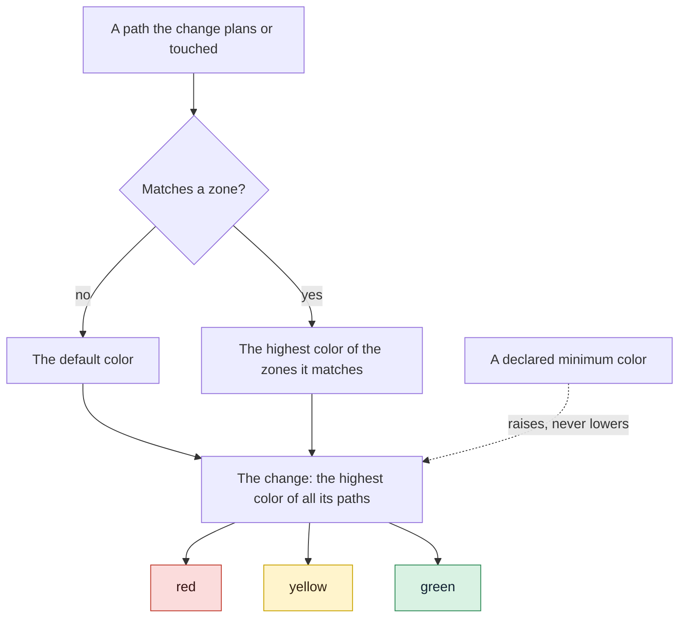

# Map and approve red zones

Use this page to tell gdd which parts of your project are risky. A red zone is a set of paths
where a mistake would be serious, such as login or payments: every change that touches one is
red and gets the strictest gates, so the strict checks go where the risk is. You name the
sensitive areas in words, the Orchestrator turns them into zones, and you approve the red ones
once.

## Before you start

- A project set up with `gdd init`, whose Brief (`docs/brief.md`) names the sensitive areas in
  words. See the [quickstart](../getting-started/quickstart.md) or
  [Bring gdd to an existing project](adopt-existing-project.md).
- Real folders to map. GDD maps red zones at the end of Discover, once the architecture and the
  first scenarios exist; before that, unmapped code is yellow.

The examples use `shop`, a small web shop on the TypeScript stack.

## How a path gets its color

Follow a path from the top: the zones it matches decide its color, and the highest color of
all the paths decides the color of the change.



## 1. Name the sensitive areas

The last step of the Setup form asks what would be serious if it failed, and `/gdd-setup` asks
again. The answers go to the Brief, in words. In `shop`:

```text
## What would be serious if it failed (sensitive areas, in words)

These become red zones at the end of Discover, once there are real folders:

1. Someone logs in as another customer
2. Charging a customer twice
```

Each area becomes one red zone, with the area as its reason. If you want to add one later, tell
the Orchestrator.

## 2. Let the Orchestrator map them

At the end of `/gdd-discover`, once the architecture and the first scenarios exist, the
Orchestrator translates the sensitive areas into paths in `gdd/zones.toml`: red, and green
where it is obvious. When the Orchestrator is unsure between two colors, it picks the higher
one; if you edit the map yourself, do the same. `gdd init` already wrote two red zones every
project has: the harness, the files gdd uses to check your project (`gdd/**`, the continuous
integration (CI) workflow and the agents' folders, among others) and the supply chain of each stack (for TypeScript,
`package.json`, `package-lock.json`, `.npmrc` and the osv-scanner files). The Orchestrator adds
yours at the end:

```toml
[[zone]]
color = "red"
paths = ["src/auth/**"]
reason = "Someone logs in as another customer"

[[zone]]
color = "red"
paths = ["src/payments/**"]
reason = "Charging a customer twice"
```

When it finds a new sensitive area while preparing a change, it adds the zone on main first, so
you approve it at that change's sitting.

How to read the map:

| Key | Where | What it says |
|---|---|---|
| `default` | top of the file | The color of a path no zone matches. `yellow` by default: code without a zone is code without known tests. |
| `color` | each `[[zone]]` | `green`, `yellow` or `red`. Any other word is an error. |
| `paths` | each `[[zone]]` | Patterns from the project root. |
| `reason` | each `[[zone]]` | Why the zone has its color, in words. The classification and the sitting show it. |

| Pattern | Matches | Does not match |
|---|---|---|
| `docs/**` | `docs/a.md`, `docs/guide/deep/page.txt` | `notes/readme.md` |
| `*.md` | `readme.md` | `notes/readme.md`: one star stays inside a folder |
| `src/*/mod.rs` | `src/a/mod.rs` | `src/a/b/mod.rs` |
| `**/secrets.toml` | `secrets.toml` at the root, `config/secrets.toml` | |

`?` matches one character other than `/`. When a path matches several zones, the highest color
wins, whatever their order in the file: a green zone inside a red one does not make its paths
green. A color that is not one of the three stops every command that reads the map:

```text
error: gdd/zones.toml: unknown color "crimson" (use green, yellow or red)
```

> [!NOTE]
> The zone map is part of the harness: `gdd/**` is red and protected from every agent that
> builds or reviews. It changes on main, outside any change. A change branch that edits it is
> a red change, and Path Guard fails any Builder that touches it.

## 3. See the color a change gets

When the Orchestrator creates a change, it tells you its color. Behind it, gdd gives a reason
for each path; this is what it printed for `login-rate-limit`:

```text
{
  "change": "login-rate-limit",
  "color": "red",
  "lane": "full",
  "reasons": [
    "docs/security.md -> green (Documentation)",
    "src/auth/login.ts -> red (Someone logs in as another customer)",
    "src/ui/login-form.ts -> yellow (no zone: default color)"
  ],
  ...
```

A red change needs a plan you approve, the Reviewer's deep review, mutation testing and the
Release Gate (G4), whatever the rules table says: see
[How risk picks the gates](../explanation/risk.md). If you know a change is riskier than its
paths say, tell the Orchestrator: it can raise the color, never lower it.

## 4. Approve the red zones

Only a person approves red zones, once for the whole project. It happens at the sitting of the
first change: the Orchestrator lists the zones waiting, each with its reason, next to the
scenarios, and your OK records them too. On the sitting screen (`gdd sitting CHANGE`) they show
under `Red zones to approve` (see [Approve the scenarios](write-scenarios.md#4-approve)).
Approving records:

```text
Red zones ok (4 red zone(s)).
```

The count includes the two zones `gdd init` wrote. Approving again with nothing changed only
says so:

```text
Red zones ok (4 red zone(s)): already approved, nothing changed.
```

The machines cannot approve them: `--by machines` is refused with
`error: Red zones are approved by a human (--by human).` The approval lives in
`.gdd/zones.json`, with a hash of the red zones as they were.

## 5. Know what waits for the approval

`/gdd-status` tells you when the red zones are pending: they go to you with the scenarios of
the next change. `gdd status` says:

```text
Red zones: pending · Red zones not approved yet: the Orchestrator proposes them at the end of Discover.
```

Until a person approves them, only spikes can be built: a Spike explores and never merges its
code (see [Explore with a spike](spikes.md)). Every other change is refused before any agent
runs:

```text
error: Red zones not approved yet: the Orchestrator proposes them at the end of Discover. (gdd gate zones ok --by human)
```

## 6. Approve again when the red zones change

Adding, removing or editing a red zone (its paths, its reason, any key) withdraws the approval.
Here `src/refunds/**` joins the payments zone:

```toml
[[zone]]
color = "red"
paths = ["src/payments/**", "src/refunds/**"]
reason = "Charging a customer twice"
```

`gdd status` then says:

```text
Red zones: pending · Red zones changed after their approval: a human must approve them again.
```

and no change but a spike starts until you approve them again, at the next sitting.

The approval covers the red zones only. Changing a green or yellow zone, or the `default`
color, does not ask for it again, yet it can lower the color of paths: read those edits in the
commit that makes them.

## Under the hood

The map is `gdd/zones.toml` ([every key](../reference/configuration.md#zonestoml)).
[`gdd new-change`](../reference/cli/new-change.md) and
[`gdd classify`](../reference/cli/classify.md) print the color and the reasons; `--min-color`
is how the Orchestrator raises a color. Your OK runs
[`gdd gate zones ok --by human`](../reference/cli/gate.md), and
[`gdd status`](../reference/cli/status.md) says whether the red zones are approved.

## Next steps

- [Approve the scenarios](write-scenarios.md): the sitting where zones, scenarios and the red
  plan are approved together.
- [How risk picks the gates](../explanation/risk.md): what each color gets, and why color wins.
- [Explore with a spike](spikes.md): the only work that starts before the zones are approved.
- [The discover skill](../reference/skills/discover.md): where the Orchestrator maps the zones.
