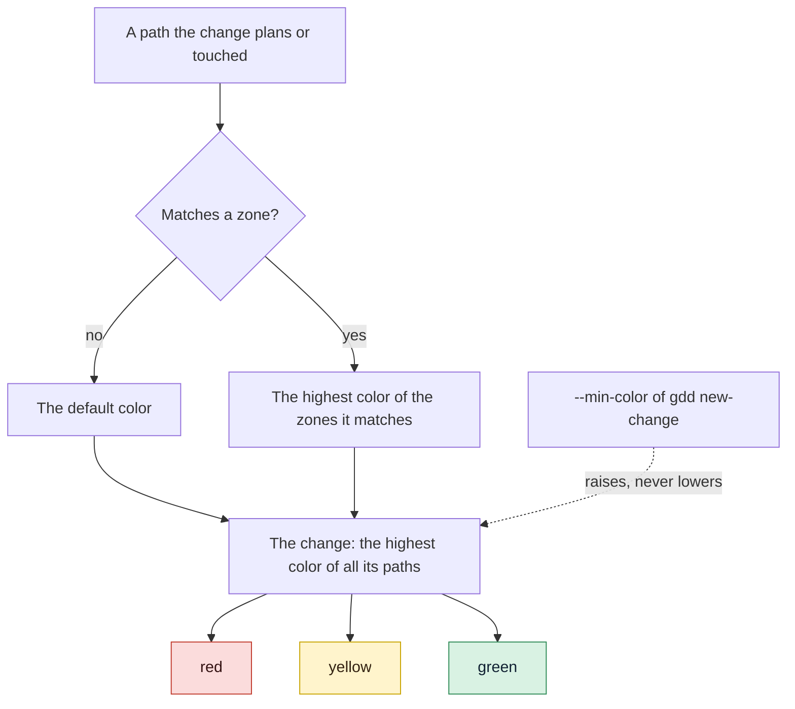

# Map and approve red zones

A red zone is a set of paths where a mistake would be serious: every change that touches one is
red, and red changes get the strictest gates. This page shows how to turn the sensitive areas of
your Project Brief into zones in `gdd/zones.toml`, check the color a change gets, and approve
the red zones so changes can be built.

## Before you start

- A project set up with `gdd init`, with the sensitive areas written in words in
  `docs/brief.md`. See [Bring gdd to an existing project](adopt-existing-project.md) or the
  [tutorial](../getting-started/tutorial.md).
- Real folders to map. GDD maps red zones at the end of Discover, once the architecture and the
  first scenarios exist; before that, unmapped code is yellow.

The examples use `shop`, a small web shop on the TypeScript stack. Run every command from the
project root, on main.

## How a path gets its color

Follow a path from the top: the zones it matches decide its color, and the highest color of
all the paths decides the color of the change.



## 1. Read the sensitive areas in the Brief

`gdd init --sensitive` writes them in the Brief, one area each time. In `shop`:

```text
## What would be serious if it failed (sensitive areas, in words)

These become red zones at the end of Discover, once there are real folders:

1. Someone logs in as another customer
2. Charging a customer twice
```

Each area becomes one red zone, with the area as its reason.

## 2. Write the zones in `gdd/zones.toml`

`gdd init` already writes two red zones that every project has: the harness itself (`gdd/**`,
`bin/**`, the CI workflow and the agents' folders) and the supply chain of each stack (for
TypeScript, `package.json`, `package-lock.json`, `.npmrc` and the osv-scanner files). Add yours
at the end:

```toml
[[zone]]
color = "red"
paths = ["src/auth/**"]
reason = "Someone logs in as another customer"

[[zone]]
color = "red"
paths = ["src/payments/**"]
reason = "Charging a customer twice"
```

| Key | Where | What it says |
|---|---|---|
| `default` | top of the file | The color of a path no zone matches. `yellow` by default: code without a zone is code without known tests. |
| `color` | each `[[zone]]` | `green`, `yellow` or `red`. Any other word is an error. |
| `paths` | each `[[zone]]` | Patterns from the project root. |
| `reason` | each `[[zone]]` | Why the zone has its color, in words. `gdd classify` and the sitting show it. |

The patterns follow three rules:

| Pattern | Matches | Does not match |
|---|---|---|
| `docs/**` | `docs/a.md`, `docs/guide/deep/page.txt` | `notes/readme.md` |
| `*.md` | `readme.md` | `notes/readme.md`: one star stays inside a folder |
| `src/*/mod.rs` | `src/a/mod.rs` | `src/a/b/mod.rs` |
| `**/secrets.toml` | `secrets.toml` at the root, `config/secrets.toml` | |

`?` matches one character other than `/`. When a path matches several zones, the highest color
wins, whatever their order in the file: a green zone inside a red one does not make its paths
green. When in doubt between two colors, pick the higher one.

A color that is not one of the three stops every command that reads the map:

```text
error: gdd/zones.toml: unknown color "crimson" (use green, yellow or red)
```

## 3. Check the color a change gets

Commit the map on main:

```bash
git add gdd/zones.toml
git commit -m "Zone map: red zones from the Brief"
```

Every `gdd new-change` prints its classification, with the reason for each path:

```bash
bin/gdd new-change login-rate-limit --title "Limit login attempts" --paths src/auth/login.ts src/ui/login-form.ts docs/security.md
```

You should see:

```text
{
  "change": "login-rate-limit",
  "color": "red",
  "lane": "full",
  "reasons": [
    "docs/security.md -> green (Documentation)",
    "src/auth/login.ts -> red (Someone logs in as another customer)",
    "src/ui/login-form.ts -> yellow (no zone: default color)"
  ],
  ...
```

For a change that already exists, `bin/gdd classify login-rate-limit` prints the same, counting
the paths the change really touched on its branch as well as the planned ones. A red change
needs a plan the human approves, the Reviewer's deep review, mutation testing and the Release
Gate (G4), whatever the rules table says: see [How risk picks the gates](../explanation/risk.md).

> [!NOTE]
> The zone map is part of the harness: `gdd/**` is red and protected from every agent. Change
> it on main, outside any change. A change branch that edits it is a red change, and Path Guard
> fails any Builder that touches it.

## 4. Approve the red zones

Only a human approves red zones, once for the whole project. Usually this happens at the sitting
of the first change: `gdd sitting CHANGE` shows the zones waiting, each with its reason, and
approving there records them with the scenarios (see
[Write and approve scenarios](write-scenarios.md#5-approve-them-at-the-sitting)). Without a
sitting:

```bash
bin/gdd gate zones ok --by human --note "Mapped from the Brief"
```

You should see:

```text
Red zones ok (4 red zone(s)).
```

The count includes the two zones `gdd init` wrote. Approving again with nothing changed only
says so:

```text
Red zones ok (4 red zone(s)): already approved, nothing changed.
```

The machines cannot approve them: `--by machines` is refused with `error: Red zones are approved
by a human (--by human).` The approval lives in `.gdd/zones.json`, with a hash of the red zones
as they were.

## 5. Know what waits for the approval

`bin/gdd status` shows where the zones stand:

```text
Red zones: pending · Red zones not approved yet: the Orchestrator proposes them at the end of Discover.
```

Until a human approves them, only spikes can be built: a Spike explores and never merges its
code (see [Explore with a spike](spikes.md)). Every other change is refused when it is prepared,
before any agent runs:

```text
error: Red zones not approved yet: the Orchestrator proposes them at the end of Discover. (bin/gdd gate zones ok --by human)
```

## 6. Approve again when the red zones change

Adding, removing or editing a red zone (its paths, its reason, any key) withdraws the approval.
Here `src/refunds/**` joins the payments zone:

```toml
[[zone]]
color = "red"
paths = ["src/payments/**", "src/refunds/**"]
reason = "Charging a customer twice"
```

`bin/gdd status` then says:

```text
Red zones: pending · Red zones changed after their approval: a human must approve them again.
```

and no change but a spike starts until you run `bin/gdd gate zones ok --by human` again, or
approve them at the next sitting. When the Orchestrator finds a new sensitive area while
preparing a change, it adds the zone on main first, so you approve it in that change's sitting.

The approval covers the red zones only. Changing a green or yellow zone, or the `default`
color, does not ask for it again, yet it can lower the color of paths: read those edits in the
commit that makes them.

## Next steps

- [Write and approve scenarios](write-scenarios.md): the sitting where zones, scenarios and the
  red plan are approved together.
- [How risk picks the gates](../explanation/risk.md): what each color gets, and why color wins.
- [Explore with a spike](spikes.md): the only work that starts before the zones are approved.
- [Configuration: zones.toml](../reference/configuration.md#zonestoml): every key of the zone
  map.
