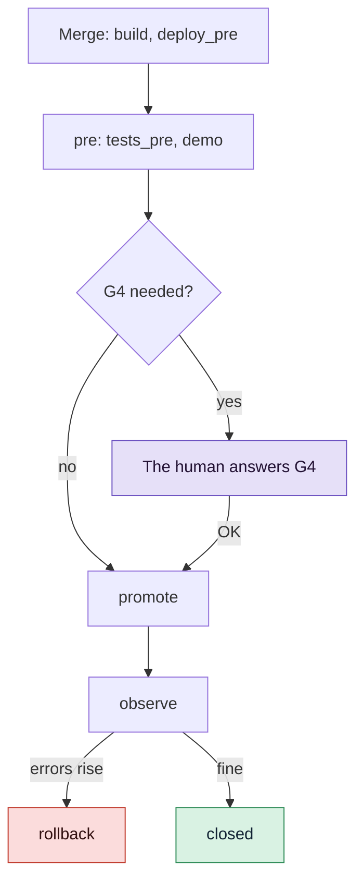

# Release versions and keep a changelog

Give each change one line for the people who use your project, keep `CHANGELOG.md` in step
with what merged, tag versions automatically or in batches, and configure the release steps
that take a change to production and roll it back.

## Before you start

- A GDD project with at least one change merged: see [Run a change](run-a-change.md).
- You know the Release Gate (G4): see [Answer the Release Gate](release-gate.md).

## 1. Give each change its changelog line

Every change carries one line in its merge commit, as git trailers:

```text
Changelog: Added · The cart shows its total
Breaking: no
```

Without a line, the change's title goes under the section of its type: Feature to `Added`,
Hotfix to `Fixed`, Migration to `Changed`. Refactor, Spike and No-code changes are left out.
The Orchestrator proposes a better line at the sitting; you can set it yourself before the
merge:

```bash
bin/gdd changelog-line cart-total Added The cart shows its total
```

```text
Changelog line of cart-total: Added · The cart shows its total
```

The section is one of Keep a Changelog's: `Added`, `Changed`, `Deprecated`, `Removed`,
`Fixed` or `Security`. Any other is refused:

```text
error: the section must be one of Added, Changed, Deprecated, Removed, Fixed, Security
```

Mark a change that breaks what worked before, or leave one out on purpose:

```bash
bin/gdd changelog-line export-csv Changed Orders export as CSV instead of JSON --breaking
bin/gdd changelog-line tidy-cart --none
```

The merge commit of `export-csv` then ends with:

```text
Changelog: Changed · Orders export as CSV instead of JSON
Breaking: yes
```

Builders and Reviewers cannot set the line. In gdd 0.1.0, a line whose words start with `--`
needs a `--` before the words: `gdd changelog-line CHANGE Changed -- --time is faster`.

## 2. Bring CHANGELOG.md up to date

`CHANGELOG.md` is yours: gdd never removes or rewrites a word of it. `gdd changelog` compares
the file with the lines the merge commits on main carry, version by version, and shows what is
missing. What no `v<semver>` tag released yet goes under Unreleased.

```bash
bin/gdd changelog
```

You should see:

```text
Missing from CHANGELOG.md:

## [Unreleased]

### Added

- The cart shows its total <!-- gdd: 2dabea449211 -->

Nothing written: gdd changelog --write adds them.
```

Add what is missing, then commit it yourself:

```bash
bin/gdd changelog --write
git add CHANGELOG.md
git commit -m "Update CHANGELOG.md"
```

```text
CHANGELOG.md: 1 line(s) added, nothing else changed.
```

Each added line carries a comment naming its commit, so a line you reword later still counts
as there. A line with the same words counts too. In a terminal, `gdd changelog` without
`--write` asks before it writes.

gdd reads the common heading styles and writes in the style of your file:

| Your file has | gdd reads it as |
|---|---|
| `## [Unreleased]`, `## Unreleased` (any case) | the Unreleased section |
| `## [0.1.0] - 2026-10-30` | Keep a Changelog |
| `## 0.1.0 - 2026-10-30` | without brackets |
| `## v0.1.0` | with a `v` |
| `## [0.1.0](<compare link>) (2026-10-30)` | a heading with a link |

New versions follow the style of your newest version heading, and a file without `###`
sections gets plain lines.

## 3. Choose how versions are made

A version is a git tag `v<major>.<minor>.<patch>`. The next one comes from the lines of the
changes since the newest tag:

| Line | Next version |
|---|---|
| `Fixed`, `Security` | patch |
| `Added`, `Changed`, `Deprecated`, `Removed` | minor |
| any line with `--breaking` | major, or minor while the major is 0 |

The first version of a project is `0.1.0`. Pick one of two modes in `gdd/rules.toml`:

- **auto** (the default, with no `[versions]` section): every change with a changelog line gets
  its version when it is promoted to production. The promote step gets it in `GDD_VERSION`;
  the tag is made only once the promotion succeeds. When the project tracks a `CHANGELOG.md`,
  its Unreleased section becomes the version in a `Release v<x.y.z>` commit, which the tag
  names.
- **manual**: promotions make no tag; you release in batches with `gdd release`.

  ```toml
  [versions]
  mode = "manual"   # release in batches with gdd release
  ```

In auto mode, a change promoted in a project that tracks a changelog looks like this on main:

```text
d78a276 Release v0.1.0
06118e8 Start CHANGELOG.md
2dabea4 gdd(cart-total): G3 Merge Gate · Cart total
```

## 4. Release by hand

`gdd release` without a step shows the next version of what main merged since its newest tag,
and releases nothing:

```bash
bin/gdd release
```

```text
Next version: v0.2.0 (from v0.1.0)

### Changed

- **Breaking:** Orders export as CSV instead of JSON

### Security

- Repeated failed logins are slowed down

Nothing released: gdd release --yes releases it.
```

Release it:

```bash
bin/gdd release --yes
```

```text
Released v0.2.0
```

This works in either mode. It adds the missing lines to `CHANGELOG.md`, turns Unreleased into
`## [0.2.0] - <day>` in a commit of its own (`Release v0.2.0`) when main tracks the file, and
makes an annotated tag `v0.2.0`. Nothing is pushed: push the commit and the tag yourself.

To choose the version, add `--version`. Without `--yes` it shows what it would release:

```bash
bin/gdd release --version 1.0.0
```

```text
Next version: v1.0.0 (from v0.2.0)

### Added

- Receipt

Nothing released: gdd release --yes releases it.
```

The version must come after the newest tag. `bin/gdd release --version 0.1.0` in a project
already at `v0.1.0` says:

```text
error: the version must come after v0.1.0
```

With nothing merged since the newest tag, `gdd release` says `Nothing to release since
v0.2.0`. Builders and Reviewers cannot release.

## 5. Configure the release steps

After the merge, the recipe takes a change through these steps, each a command in the
`[release]` section of `gdd/commands.toml`:



`gdd init` writes them empty, with `simulated = true`: empty steps pass and are logged as
simulated until you have a real pre and production. Fill them in and set `simulated = false`:

```toml
[release]
simulated = false
build = "uv build -q"                                       # build the artifact once
deploy_pre = "mkdir -p .gdd/pre && cp dist/*.whl .gdd/pre/"
tests_pre = "ls .gdd/pre/*.whl"
demo = "mkdir -p .gdd/changes/$GDD_CHANGE/demo && GDD_FEATURES= uv run pytest -q tests/acceptance > .gdd/changes/$GDD_CHANGE/demo/scenarios.txt"
promote = "./deploy.sh production $GDD_VERSION"             # the same artifact, to production
observe = "./check-error-rate.sh"                           # fails if errors rise
rollback = "./deploy.sh production previous"
rollback_pre = "./deploy.sh pre previous"                   # used by the self-test
```

`promote`, `observe` and `rollback` above call scripts of your own; the rest is a working
example for a Python package. Promote the same artifact you built once: never rebuild it for
production. Each step may run for `command_seconds` of `[limits]`. Each step also runs on its
own, which is how you try them:

```bash
bin/gdd release pre CHANGE
bin/gdd release promote CHANGE
bin/gdd release observe CHANGE
```

A change that needs the human G4 is never promoted without it
(`This change needs a human G4 before promotion.`). A promotion that fails leaves production
untouched and the change waiting at G4; the same OK retries it.

When `observe` fails, the rollback runs and the change asks for a hotfix. With an `observe`
that printed `error rate up` and exited with 1:

```text
error: release.observe failed (exit code 1):
error rate up
--- end of output ---
error rate up
Rollback: ok
Production failed while observing: rolled back to the previous version. A hotfix is needed. Message in .gdd/changes/receipt/inbox.md
```

The change is now `rolled-back`, and its Decision Inbox says what you need to decide:

```text
## Needs your decision
- Production failed while observing: rolled back to the previous version. A hotfix is needed.
```

Every key is in [Configuration](../reference/configuration.md#commandstoml).

## 6. Check the changelog in CI (optional)

`gdd changelog --check` writes nothing and fails when the file lacks a line:

```text
error: CHANGELOG.md misses 1 line(s): gdd changelog shows them, gdd changelog --write adds them
```

It prints `CHANGELOG.md covers every change on main.` when nothing is missing. Add it as a step
of your workflow on main if you keep the file by hand; see [Run the gates in CI](ci.md).

## Next steps

- [Answer the Release Gate](release-gate.md): OK, KO or polish at G4, before promotion.
- [Run the gates in CI](ci.md): what blocks a change before it merges.
- [Measure the work](measure.md): deployment frequency and change fail rate with `--dora`.
