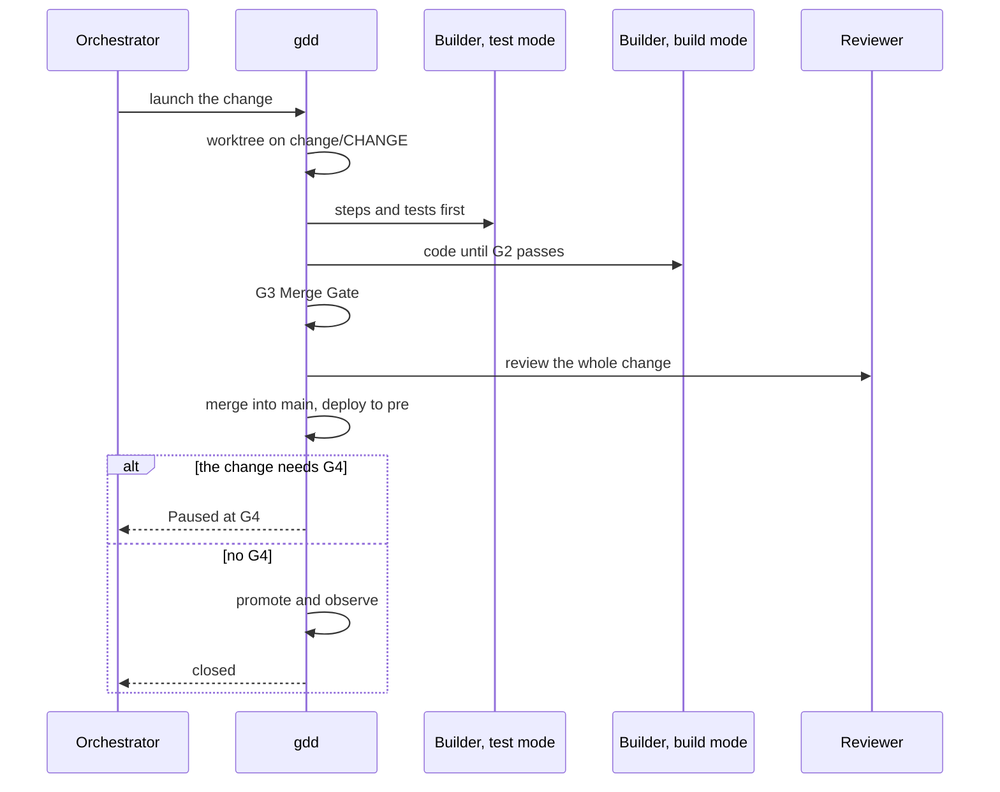

# Describe a change to your agent

Use this page whenever you want something built, fixed or reshaped. You say what you want in
one sentence. The Orchestrator turns it into a change, asks for your OK once, launches it and
comes back when the change needs you again.

## Before you start

- A project whose Setup is done: the Setup Gate (G0) is open. The
  [quickstart](../getting-started/quickstart.md) takes you there.
- Your coding agent, started in the project folder.

The examples use `shop`, a small online shop, and the change `cart-total`.

## 1. Say what you want

Run the change skill with what you want, in your own words. In Claude Code and OpenCode:

```text
/gdd-change show the cart total, taxes included
```

In Codex:

```text
$gdd-change show the cart total, taxes included
```

Say what and why, not how: who uses it, what they should be able to do, what must not happen.
Leave the code to the agents. If you already have a short id in mind, put it first
(`/gdd-change cart-total ...`).

If what you have in mind is bigger than one small piece of value, start with `/gdd-discover`
instead. It explores the options with you and proposes the next changes in
order, each one small. See [the discover skill](../reference/skills/discover.md).

## 2. Read what the Orchestrator decided

The Orchestrator is the role your agent plays in this conversation. It turns your sentence into
a change and decides four things for you:

| It decides | What it is |
|---|---|
| The id | lowercase letters, digits and hyphens, such as `cart-total` |
| The title | what the change is about, in a few words; the changelog line of a Feature, Hotfix or Migration |
| The type | `Feature` (the default), `Hotfix`, `Refactor`, `Migration`, `Spike` or `No-code` |
| The paths | the folders and files the change plans to touch |

From those paths gdd works out the color of the change, its risk, from the
[zone map](red-zones.md). The color decides the [gates](../glossary.md#gate) the change meets:
the checks it must pass before it moves on. The Orchestrator tells you the result in its own
words. For `cart-total`, the agent answered:

<!-- The chat excerpts of this page come from one real run of gdd 0.1.0 (main at e244577) on
2026-10-31 with Claude Code: the run of the tutorial. -->

```text
I've drafted the scenarios for **cart-total**. It's yellow, so there's no plan for you to
approve and the red zones are unchanged. Before I commit them I need your OK and three answers.
...
```

Look at the color and at what it needs from you. The id, the type, the lane and every gate are
in the classification gdd printed for it (see [Under the hood](#under-the-hood)). Ask the agent
if you want them.

With the default rules, this is when you meet the change:

| The change... | You meet it |
|---|---|
| creates or changes scenarios (visible behavior) | at the sitting, to approve them, then at the Release Gate (G4) |
| is red | at the sitting, to approve its plan, then always at G4 |
| neither | never: the machines release it once every gate passes |

The color also decides how strict the gates are: a red change gets mutation testing and a deep
review. [How risk picks the gates](../explanation/risk.md) explains why.

When a choice is reversible, the Orchestrator makes it instead of asking you. It writes the
choice under *Decided without you* in the change's Decision Inbox, the one message gdd keeps
for you per change. The questions it does ask come grouped, each with its recommendation first.

## 3. Approve what needs you

The Orchestrator writes the scenarios of the change and, for a red change, its plan. Then it
holds one *sitting* with you: a single message with everything that needs your approval. That
is the scenarios as plain text, the red zones when they wait, and the plan of a red change.

The red zones are usually approved already, at the end of the Setup. They come back to a
sitting only when the zone map changed. Answer in words: OK, or what to change, with the
answers to the Orchestrator's questions. For `cart-total`:

```text
OK, as they are. My prices include tax, 21% is my rate and I sell in euros.
```

With your OK the Orchestrator records the Scenario Gate (G1), and the red zones and the plan
when they wait. [Approve the scenarios](write-scenarios.md) says what to look for, how to ask
for changes, and how to read the same sitting on a screen.

## 4. Let it launch

With your OK, the Orchestrator writes the Builder's context package (the goal in three lines,
the color, the scenarios, the paths it may touch, what to reuse), commits what is pending on
`main` and launches the change. From here the recipe runs on its own. Read the diagram top to
bottom: who acts, in order.



1. **A worktree.** The change runs in its own git worktree, a sibling folder
   `PROJECT.worktrees/CHANGE` on the branch `change/CHANGE`. Your checkout stays on `main`.
2. **Build.** The Builder in test mode writes the steps and the tests first. Then the Builder
   in build mode writes the code, and the Loop Gate (G2) checks each round. Build mode gets 3
   rounds. If G2 is still red, the Orchestrator replans once and the Builder gets one more
   round. If G2 is still red after that, the change parks with
   `G2 still red after 3 retries and 1 replan`: the 3 retries are those 3 rounds.
3. **Integrate.** The Merge Gate (G3) runs every scenario, hidden examples included, and the
   security, dependency and secrets checks, plus mutation testing for a red change. Then a
   Reviewer of another model family reads the whole change.
4. **Merge and pre.** gdd merges the change into `main`, one change at a time, builds it and
   deploys it to pre, the copy of your project that runs before production. A project without
   a real pre has `simulated = true`, and those steps pass empty.
5. **G4 or production.** A change that needs you pauses at the Release Gate. The machines
   promote and observe any other.

[The life of a change](../explanation/life-of-a-change.md) explains each step and why it is
there.

## 5. Follow it on the Board

A build takes minutes, longer for a big change. If you want to watch it, open the Board in
another terminal:

```bash
gdd board
```

It shows every change by phase: Discover for the ones not launched yet, Build for the ones
building or parked, Release for the ones in pre or waiting for your G4, and Done, folded away.
It only reads, and it reads the project when it opens: close it with `q` and open it again to
see a later state. A real Board, with `cart-total` building:

<!-- Real screen at 100 columns, blank lines trimmed, from the same run. -->
```text
┌ gdd · Board · shop ──────────────────────────────────────────────────────────────────────────────┐
│Discover (0)                                                                                      │
│Build (1)                                                                                         │
│› cart-total · yellow · Show the cart total, taxes included · building · G1:ok                    │
│Release (0)                                                                                       │
│Done (0) · d to show                                                                              │
│↑↓ move · Enter details · d done · t time · q quit                                                │
└──────────────────────────────────────────────────────────────────────────────────────────────────┘
```

The line to read is the change itself: its color, its state (`building`) and the gates it has
passed (`G1:ok`). `Enter` shows the details of the selected change: its type, color, state,
gates, paths, its Decision Inbox and where its time went. Every key is in
[Screens](../reference/screens.md).

## 6. Answer when it comes back

The change comes back to the chat in one of three ways:

- **It waits at G4.** The Orchestrator brings its Decision Inbox and its demo into the chat,
  and you answer OK, KO or polish in words. See [Review a change at G4](release-gate.md).
- **It closed.** A change that needed no G4 went to production on its own. The Orchestrator
  tells you, with what it cost.
- **It parked.** A loop ran out of tries or a check stopped it. The Orchestrator reads why
  and proposes the next step in one line. See
  [Get a parked change going again](parked-change.md).

Two minutes after the launch, `cart-total` came back waiting at G4:

```text
The **cart-total** change is built and checked, and it's waiting for your **G4** answer.
...
**Next step:** reply **OK** to send it to production (simulated for now), **KO** to reject it,
or **polish** with what you'd like changed.
```

If you closed the chat meanwhile, start your agent again and run `/gdd-status`
(`$gdd-status` in Codex). It says where the project stands and gives one next step, such as the change waiting
for your G4.

## Without an agent

Every step above is a gdd command the Orchestrator runs for you, and you can run them
yourself: [`gdd new-change`](../reference/cli/new-change.md) creates the change and prints its
classification, [`gdd sitting`](../reference/cli/sitting.md) or
[`gdd gate`](../reference/cli/gate.md) records the sitting,
[`gdd launch`](../reference/cli/launch.md) runs the recipe and
[`gdd resume`](../reference/cli/resume.md) answers G4. Then you also write the scenarios on the
change's branch and the package in `.gdd/changes/CHANGE/package.md`, as the
[change skill](../reference/skills/change.md) describes.

## Under the hood

The change skill runs [`gdd status`](../reference/cli/status.md) to check that G0 is open, then
[`gdd new-change`](../reference/cli/new-change.md), which writes the record in
`.gdd/changes/CHANGE/change.json`, creates the branch `change/CHANGE` and prints the
classification ([`gdd classify`](../reference/cli/classify.md) prints it again). Your OK
becomes [`gdd gate`](../reference/cli/gate.md) lines, what it decided alone becomes
[`gdd note`](../reference/cli/note.md), and [`gdd launch`](../reference/cli/launch.md) runs the
recipe. [`gdd inbox`](../reference/cli/inbox.md) prints the Decision Inbox and
[`gdd report`](../reference/cli/report.md) what the agent calls cost.

## Next steps

- [Approve the scenarios](write-scenarios.md): what to read at the sitting, and how to ask for
  changes.
- [Review a change at G4](release-gate.md): the Decision Inbox, the demo and your answer.
- [Run changes in parallel](parallel-changes.md): a second change while the first builds.
- [The change skill](../reference/skills/change.md): everything the Orchestrator does, step by
  step.
