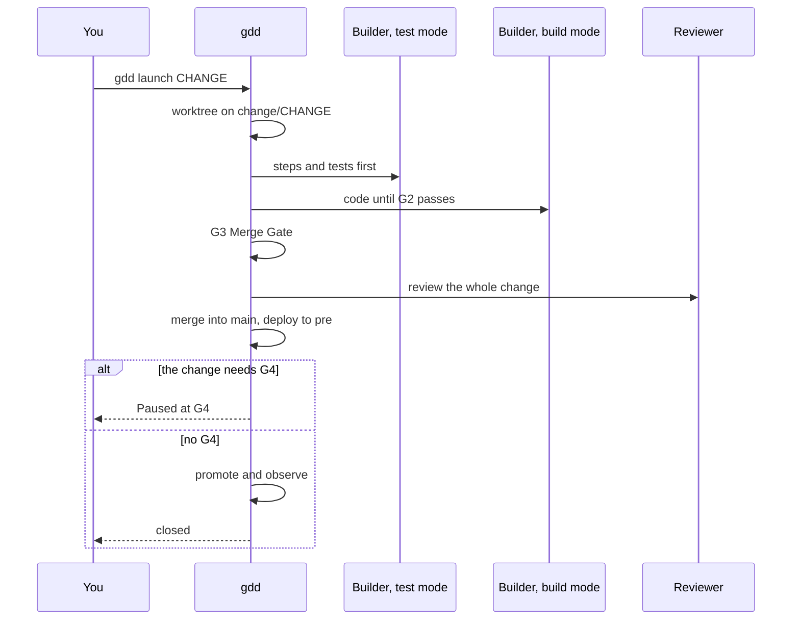

# Run a change

Create a change, read how gdd classified it, launch it and follow it until it closes, parks
or waits for you at the Release Gate.

## Before you start

- A project set up with [`gdd init`](../reference/cli.md#gdd-init) and
  [`gdd bootstrap`](../reference/cli.md#gdd-bootstrap), with G0 open: `bin/gdd status` says
  `G0: ok`. [Your first change](../getting-started/tutorial.md#3-open-g0-the-setup-gate)
  shows how.
- Everything committed on `main`.

In a project with agents you usually let the Orchestrator do steps 1 to 3 in a conversation
(`/gdd-change` in Claude Code, `$gdd-change` in Codex): it runs the same commands. This page
shows the commands, so you know what it does and can do it yourself.

## 1. Create the change

```bash
bin/gdd new-change CHANGE --title "TITLE" --paths PATH...
```

- `CHANGE` is the id: lowercase letters, digits and hyphens, such as `export-csv`.
- `--title` says what the change is about, in a few words. It becomes the changelog line
  unless you set another with [`gdd changelog-line`](../reference/cli.md#gdd-changelog-line).
- `--paths` lists the paths the change plans to touch. Patterns are allowed (`"src/notes/**"`;
  quote them so the shell does not expand them). They decide the color, and the scope check
  of G2 compares what the Builder touched against them.
- `--type` is the kind of work: `Feature` (the default), `Hotfix`, `Refactor`, `Migration`,
  `Spike` or `No-code`. A `Spike` runs a recipe of its own: see
  [Explore with a spike](spikes.md).
- `--min-color red` raises the color when you know the risk is higher than the paths say. It
  never lowers it.
- `--resumable` says another agent could pick the change up from its record alone, one of the
  three conditions of the fast lane.

For example:

```bash
bin/gdd new-change export-csv --title "Export notes as CSV" \
  --paths "src/notes/**" "tests/**" features/export_csv.feature
```

gdd writes the change's record in `.gdd/changes/export-csv/change.json`, creates the branch
`change/export-csv` from `main`, logs it, and prints the classification.

## 2. Read the classification

The JSON that `new-change` prints is the plan of gates for this change. Print it again at any
time, from the planned paths plus what the branch has touched so far:

```bash
bin/gdd classify export-csv
```

```text
{
  "change": "export-csv",
  "color": "yellow",
  "lane": "full",
  "reasons": [
    "features/export_csv.feature -> yellow (no zone: default color)",
    "features/hidden/export_csv.feature -> yellow (no zone: default color)",
    "src/notes/** -> yellow (no zone: default color)",
    "tests/** -> yellow (no zone: default color)"
  ],
  "g1": true,
  "features": [
    "features/export_csv.feature",
    "features/hidden/export_csv.feature"
  ],
  "tests_first": true,
  "mutation": false,
  "reviewer": true,
  "review": "quick",
  "g4": true,
  "human_plan": false,
  "type": "Feature",
  ...
  "builder_session": "separate",
  "retries": 3
}
```

| Field | Says |
|---|---|
| `color` | green, yellow or red: the highest color of any path, from `gdd/zones.toml`. Paths in no zone take the map's `default`. |
| `lane` | `fast` (G2 and G3, no human stop) or `full`. |
| `reasons` | why each path got its color. |
| `g1` | the change creates or changes a `.feature`, so a human approves the scenarios before the build. |
| `features` | the scenario files of the change, which G2 runs. |
| `tests_first` | the Builder writes the steps and tests in test mode before any code. |
| `mutation` | G3 runs mutation testing on the diff. Always true for red. |
| `reviewer`, `review` | a Reviewer reads the change, and how deep: `quick` or `deep` (always deep for red). |
| `g4` | the change waits for a human at the Release Gate. |
| `human_plan` | a red change: the human approves its plan at the sitting. |
| `builder`, `builder_test`, `reviewer_model`, `orchestrator` | the agent and model of each role, from `gdd/models.toml`. |
| `retries` | Builder rounds against G2 before the Orchestrator replans. |

What each color gets comes from `gdd/rules.toml`; [Gates](../reference/gates.md) lists it
all and [How risk picks the gates](../explanation/risk.md) explains why.

## 3. Prepare what the Builder needs

On the change's branch, write the scenarios when the change has visible behaviour, then come
back to `main`:

```bash
git switch change/export-csv
# write features/export_csv.feature and features/hidden/export_csv.feature
git add features
git commit -m "Scenarios of export-csv"
git switch main
```

[Write and approve scenarios](write-scenarios.md) says how. Then, in the change's state
folder, `.gdd/changes/CHANGE/`:

- `package.md`, the Builder's context package: the goal in three lines, the color, the
  scenarios it covers, the paths it may touch and what to reuse. Nothing else.
- `plan.md`, for a red change only: what, how, the risks and how to roll back, in words, never
  code. You approve it at the sitting.

Anything decided along the way goes to the change's Decision Inbox:

```bash
bin/gdd note export-csv decided Kept one column
bin/gdd note export-csv needs Should the header say note or text
```

Each prints `noted`.

## 4. Approve at the sitting

```bash
bin/gdd sitting export-csv
```

The sitting shows the scenarios from the branch, the hidden examples, the red zones that wait
and the plan of a red change. `a` approves all of it, `c` asks for changes; both confirm first.
Without a terminal, record the same with `gdd gate`:

```bash
bin/gdd gate G1 ok export-csv --by human
bin/gdd gate zones ok --by human
bin/gdd gate plan ok export-csv --by human
```

The second line only when the red zones wait, the third only for a red change.
[The tutorial](../getting-started/tutorial.md#7-approve-at-the-sitting) shows the screens.

## 5. Launch it

From the main checkout, with your work committed:

```bash
bin/gdd launch export-csv
```

Before it starts anything, gdd checks that the change may enter Build: G0 open, the red zones
approved, G1 recorded when the change has scenarios, the plan approved when it is red, and a
Reviewer of another model family than the Builder. It refuses a tracked file left uncommitted:

```text
error: The working tree has uncommitted changes. Commit them before launching a change.
```

It also refuses a change when `[parallel] max` changes are already building (2 by default, in
`gdd/rules.toml`), and warns when another change in flight plans to touch the same paths: git
settles that when the second one merges. [Run changes in parallel](parallel-changes.md) has the
details.

Then it runs the recipe. The diagram shows who acts, in order:



1. **A worktree.** The change runs in its own git worktree, a sibling folder
   `PROJECT.worktrees/CHANGE` on the branch `change/CHANGE` (`[parallel] folder` in
   `gdd/rules.toml` moves it). Your checkout stays on `main`, and every worktree shares the
   main checkout's `.gdd/`.
2. **Build.** When `tests_first` is true, the Builder in test mode writes the steps and the
   tests first. Then the Builder in build mode writes the code, each round followed by the
   Loop Gate (G2). After 3 rounds still red, the Orchestrator replans once, which may send the
   change back to test mode, and the Builder gets one more round.
3. **Integrate.** The Merge Gate (G3) runs every scenario, hidden examples included, and the
   security, dependency, secrets and, when the change gets it, mutation checks. Red gets one
   fix by the Builder. Then the Reviewer: a KO gets one fix and a second review.
4. **Merge.** gdd merges the branch into `main`, one change at a time, with the change's record
   in the merge commit. When `main` moved meanwhile, the change takes it and passes G3 again
   first.
5. **Pre.** It runs the release steps `build`, `deploy_pre`, `tests_pre` and `demo` of
   `gdd/commands.toml`. A project without a real pre has `simulated = true` there: empty steps
   pass and the log says they were simulated.
6. **G4 or production.** A change with `g4` pauses for you; any other is promoted and observed
   by the machines.

Around every agent call, gdd checks that the agent did not touch GDD state, and that the
Reviewer changed no file. Either parks the change. [The life of a change](../explanation/life-of-a-change.md)
follows each step in detail.

`gdd launch` prints nothing while it works, then one line. A change that waits for you:

```text
Paused at G4. Message: .gdd/changes/export-csv/inbox.md · To continue: gdd resume export-csv --g4 ok|ko|polish
```

A change that needed no G4 goes on to production and ends as an OK at G4 does, after a
`Released vX.Y.Z` line when it got a version:

```text
Change export-csv closed. Message: .gdd/changes/export-csv/inbox.md · Tokens: gdd report --change export-csv
```

A change that parked, with exit code 1:

```text
Change export-csv parked: G2 still red after 3 retries and 1 replan. Message in .gdd/changes/export-csv/inbox.md
```

## 6. Follow it

From another terminal, while it runs, or any time after:

```bash
bin/gdd status
```

lists each change with its state and the gates it passed:

```text
...
Changes:
  - export-csv · Export notes as CSV · in-pre · G1:ok, G3:ok
Log: 30 lines in .gdd/log.jsonl (gdd report)
```

A change goes from `open` to `prepared` and `building` (`polishing` in a polish round), then
`in-pre`, where it waits at G4, and ends `closed`. On the way it can end `parked`, `rejected`
at G4 or `rolled-back` after a failed observation.

The Board shows every change by phase: Discover for the ones not launched, Build for the ones
building or parked, Release for the ones in pre or waiting for your G4, and Done, folded. It
writes nothing.

```bash
bin/gdd board
```

| Key | Does |
|---|---|
| `↑` `↓` | moves the selection |
| `Enter` | the details of the selected change: type, color, state, gates, paths, its inbox and where its time went; `Esc` goes back |
| `d` | shows or folds Done |
| `t` | the project's time report |
| `q` | closes the Board |

The Decision Inbox of the change is the one message it keeps for you: what needs your
decision, what was decided without you and why it parked, if it did. It is also saved in
`.gdd/changes/CHANGE/inbox.md`:

```bash
bin/gdd inbox export-csv
```

What the agent calls of a change cost, by role and model:

```bash
bin/gdd report --change export-csv --by role,model
```

```text
role · model -> calls · tokens in · cache · out · cost USD · seconds
builder-build · sonnet -> 1 · 19,650 · 144,619 · 1,385 · 0.1069 · 32
builder-test · sonnet -> 1 · 24,440 · 241,757 · 3,083 · 0.1527 · 29
reviewer · gpt-6-astra -> 1 · 22,312 · 88,320 · 975 · 0.0000 · 32
TOTAL -> in 66,402 · cache 474,696 · out 5,443 · 0.2596 USD
Human stops logged: 1
```

## 7. When it parks

A change *parks* when a loop runs out of tries or a check stops it: G2 still red after the
retries and the replan, G3 or the Reviewer still saying no after their one fix, an agent that
touched GDD state or timed out, a merge conflict. Nothing is lost: the worktree and the branch
stay, and the Decision Inbox says why.

This is a real park. The Builder's code was right, but the project's tools could not run the
scenario, and the Orchestrator's replan said so. It came from an earlier build of gdd 0.1.0,
whose Python skeleton let pytest reach 9.2; the skeleton now keeps pytest below 9.2, so a new
project does not park this way:

```bash
bin/gdd inbox export-csv
```

```text
# Decision Inbox · export-csv · Export notes as CSV

Color yellow · lane full · state parked

## Needs your decision
...
- Replan: G2 acceptance is blocked by the harness, not by this change. uv.lock (from gdd bootstrap, 3639758) pins pytest 9.2.0 with pytest-bdd 9.0.0; pytest-bdd 9.0.0 reads FixtureManager._arg2fixturedefs, which pytest 9.2.0 no longer has, so every pytest-bdd scenario fails before its first step. pyproject.toml has only lower bounds (pytest>=9.1.1, pytest-bdd>=9.0.0). The human must pick a compatible pair (cap pytest below 9.2, or a pytest-bdd release that supports pytest 9.2; I did not verify either), then relock and sync, outside this change. After that, rerun the build round; no code change is needed before it.
...

## Parked
- G2 still red after 3 retries and 1 replan
```

To get it going again:

1. Read the inbox and fix the cause. When the fix is outside the change, as here, commit it on
   `main`.
2. Launch it again: `bin/gdd launch CHANGE`. A relaunch keeps the worktree, commits the work
   of the earlier run once its gates accept it, and folds the requests the earlier run left.
   When the code already passes G2, the Builder is skipped and the recipe goes on from G3.

[Get a parked change going again](parked-change.md) covers each reason to park, merge
conflicts included.

You can also park a change yourself, for example while you wait for an answer. It always exits
with 1:

```bash
bin/gdd park export-csv Waiting for a decision on the CSV header
```

```text
Change export-csv parked: Waiting for a decision on the CSV header. Message in .gdd/changes/export-csv/inbox.md
```

## 8. When it waits at G4

A change that pauses at the Release Gate is merged into `main` and in pre. It keeps its
worktree, stays in state `in-pre` and no longer counts toward `[parallel] max`, so other
changes can build meanwhile. It waits for your answer, as long as it takes:

```bash
bin/gdd resume export-csv --g4 ok
```

`ok` promotes it, `ko` keeps it out of production and `polish --note "..."` runs one more
Builder round with your notes. [Answer the Release Gate](release-gate.md) says what to check
first.

## Next steps

- [Answer the Release Gate](release-gate.md): OK, KO or polish, and what to look at before.
- [Get a parked change going again](parked-change.md): every reason to park and its way out.
- [Run changes in parallel](parallel-changes.md): the cap, overlaps and the merge queue.
- [The life of a change](../explanation/life-of-a-change.md): every step of a launch, in order.
