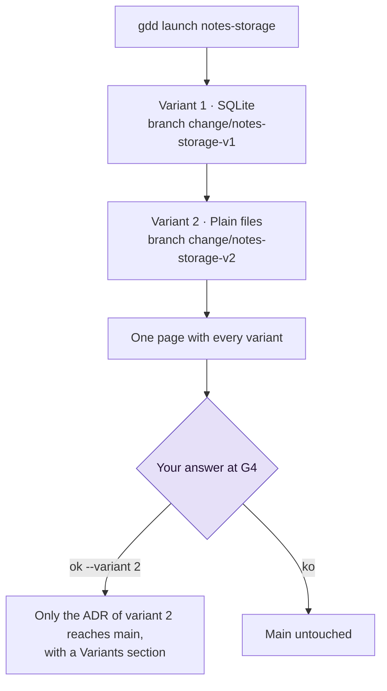

# Explore with a spike

A spike answers one question before the real work, with a fixed budget: the Builder writes
throwaway code to find out, and what reaches main is only the decision, in an ADR. This page
shows how to run a spike, keep it within its budget, and build several variants side by side to
pick one.

## Before you start

- A project whose Setup is done (`G0: ok` in `bin/gdd status`). A spike is the only change that
  can be built before the red zones are approved (see [Map and approve red zones](red-zones.md)).
- A question that blocks a decision, such as "where do the notes live?". Discover is where
  spikes come from: see [GDD in one page](../explanation/method.md).

The examples use the project `notes`.

## What a spike gets, and what it skips

A Spike runs a recipe of its own. Because its code never merges, it skips what guards code on
its way to main:

| A Spike... | Because |
|---|---|
| has no test mode, no mutation testing, no Reviewer, no G3, no merge and no pre | only its ADR reaches main |
| is built by the Builder in build mode, with `mode=spike` | it writes code to answer a question, not to keep |
| passes G2 with Path Guard and an ADR: a new or changed `docs/adr/*.md` with a `## Decision` line | the project's G2 commands do not run on throwaway code |
| always waits for a human at the Release Gate (G4) | you decide what the ADR says |
| has a budget, `[spike] max_usd` | a fixed cost, the way Discover asks |
| needs no plan, even when red | it keeps the red Builder, and you approve the ADR at G4 |

## 1. Set the budget

`gdd init` writes the budget in `gdd/rules.toml`:

```toml
[spike]
max_usd = 5   # a spike parks when its agent calls cost this much (USD)
```

Change it on main if 5 USD does not fit your spikes (see
[Configuration](../reference/configuration.md#spike)). It must be a positive number: `0` is
refused with `spike.max_usd must be a positive number of USD, not 0`.

gdd keeps what each change spent in its record, which only gdd writes: after every agent call it
adds the cost the agent reported to `spent_usd` and the tokens to `spent_tokens`, in
`.gdd/changes/<id>/change.json`. The budget reads it from there, not from the log, so a line an
agent adds to the log cannot lift it. The budget is checked between calls: a call is never cut
in the middle, so a spike can end a little over it.

> [!NOTE]
> The budget counts what agents report. Codex reports no cost: its calls count as 0 USD unless
> `[prices.<model>]` in `gdd/models.toml` gives the price of its model. With a subscription the
> cost is notional, so compare tokens too (`bin/gdd report --change <id>`).

## 2. Create the spike

```bash
bin/gdd new-change notes-sync --type Spike --title "How notes sync between laptops" --paths "src/sync/**" docs/adr/0003-sync.md
```

You should see:

```text
{
  "change": "notes-sync",
  "color": "yellow",
  "lane": "full",
  "reasons": [
    "docs/adr/0003-sync.md -> green (Documentation)",
    "src/sync/** -> yellow (no zone: default color)"
  ],
  "g1": false,
  "features": [],
  "tests_first": false,
  "mutation": false,
  "reviewer": false,
  "review": "quick",
  "g4": true,
  "human_plan": false,
  "type": "Spike",
  ...
```

Write the question and what would answer it in the change's package
(`.gdd/changes/notes-sync/package.md`) as for any change: the Orchestrator's `gdd-change`
command does it for you.

## 3. Launch it

```bash
bin/gdd launch notes-sync
```

The Builder works on the branch `change/notes-sync`, in its own worktree, and writes the
decision in a new file under `docs/adr/`, with a `## Decision` section. When G2 passes, the
launch says which ADR files OK would bring to main and pauses at G4. Nothing reaches main yet.

A spike parks instead when:

- it leaves no ADR: G2 fails with `a Spike leaves its decision in a new file under docs/adr/
  with a ## Decision section`, and after the retries the change parks with `G2 still red`;
- it reaches its budget: `parked: the spike spent 0.02 USD of its budget of 0.02 USD` (here
  with `max_usd = 0.02`).

See [Get a parked change going again](parked-change.md) for what to do next.

## 4. Answer its Release Gate

Read the ADR on the spike's branch, then answer, at the sitting (`bin/gdd sitting notes-sync`)
or from the command line:

```bash
bin/gdd resume notes-sync --g4 ok --note "Plain files and git: no server to run"
```

| Answer | What happens |
|---|---|
| `--g4 ok` | Only the ADR files of the branch reach main, in one commit `gdd(notes-sync): Spike ADR · How notes sync between laptops`. The code stays on `change/notes-sync`, which gdd keeps. |
| `--g4 ko --note ...` | Main stays as it was. |
| `--g4 polish --note ...` | One more Builder round with your notes, with no retry or replan, then G2. Still red, the change parks. |

There is no demo, no promotion and no changelog line: a spike delivers a decision, not a
feature. The real work comes after, as a new change built with all its gates.

## 5. Try several options at once with variants

When the question has 2 to 4 options, build one variant per option and compare them on one page
(set-based design: explore a set of alternatives, then narrow it down). Give each option with
`--option`:

```bash
bin/gdd new-change notes-storage --type Spike --title "Where the notes live" --paths "src/store/**" docs/adr/0002-storage.md --option SQLite --option "Plain files"
```

The record lists the variants, each with its branch:

```json
"variants": [
  {
    "option": "SQLite",
    "branch": "change/notes-storage-v1"
  },
  {
    "option": "Plain files",
    "branch": "change/notes-storage-v2"
  }
]
```

With no options to tell apart, `--variants N` builds N variants of the same brief.
gdd refuses the rest before it writes anything. For example, `--variants 5`, both flags at once,
and variants on a change that is not a Spike (`gdd new-change x1 --title X --variants 2`):

```text
error: a spike has 2 to 4 variants, not 5
error: --option and --variants do not go together: one variant for each option, or n variants of the same brief
error: only a Spike has variants, and x1 is a Feature: add --type Spike, or leave out --option and --variants
```

Read the diagram top to bottom: one launch builds every variant, and you pick at G4.



What a launch with variants does:

- It builds the variants one after another, each by its own Builder (`mode=spike variant=<n>`),
  on its own branch `change/<id>-v<n>`, with the gate of a spike.
- Each variant has its own budget: `[spike] max_usd` counts what that variant's calls spent
  (`usd` and `tokens` of each variant in the record), and it is the variant that parks. Two
  variants can spend up to twice the budget.
- A variant that fails its gate or reaches its budget does not stop the others. When none
  passes, the spike parks with `no variant passed its gate`.

## 6. Compare the variants and pick one

When the last variant is built, the spike waits at G4. Its page, in `bin/gdd sitting
notes-storage` and in the Decision Inbox, has one line per variant: whether it is ready or
parked and why, its ADR files, the first line of its decision, how many files it changed, its
minutes and its cost. The lines look like this (illustrative, not from a run):

```text
## Variants
- Variant 1 · SQLite · ready · ADR: docs/adr/0002-storage.md · decision: SQLite, one file per notebook. · 4 files · 6.1 min · 0.84 USD
- Variant 2 · Plain files · ready · ADR: docs/adr/0002-storage.md · decision: One Markdown file per note. · 3 files · 4.8 min · 0.52 USD
```

You compare and pick; no agent judges the variants. At the sitting, `o` (OK) and `p` (polish)
ask `Which variant? Its number:`. From the command line:

```bash
bin/gdd resume notes-storage --g4 ok --variant 2 --note "Plain files keep working with git"
```

Only the ADR files of variant 2 reach main, in the commit `gdd(notes-storage): Spike ADR ·
Where the notes live`, and gdd adds a `## Variants` section to the ADR that names the choice and
every variant not chosen with its branch, for example:

```text
## Variants
Chosen: variant 2 (Plain files), branch change/notes-storage-v2. Plain files keep working with git
Variant 1 (SQLite): not chosen, branch change/notes-storage-v1
```

The code of every variant stays on its branch. Without `--variant`, OK is refused with `pick a
variant: gdd resume notes-storage --g4 ok --variant 1|2`, and a variant that did not pass its
gate cannot be picked. `--g4 polish --variant <n> --note ...` builds that variant again with your
notes; `--g4 ko` rejects them all.

## Next steps

- [Answer the Release Gate](release-gate.md): the G4 page, OK, KO and polish.
- [Measure the work](measure.md): what spikes and changes cost, in tokens and USD.
- [Run a change](run-a-change.md): build the decision of the ADR as a real change.
- [Command reference: gdd new-change](../reference/cli.md#gdd-new-change): `--option` and
  `--variants`.
