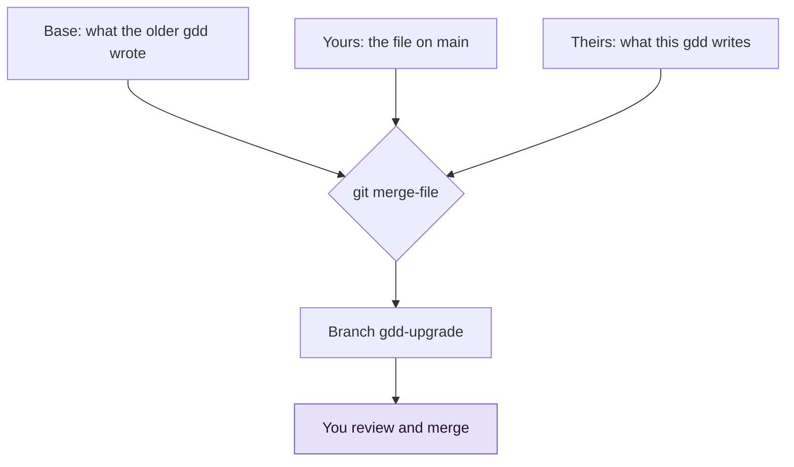

# Upgrade gdd in a project

Use this guide when a new gdd version is out and you want a project to use it. gdd proposes
its new files on a branch, merged with your own edits, so you review the upgrade before it
reaches main.

## Before you start

- The project was set up with [`gdd init`](../reference/cli/init.md), so it has
  [`gdd/generated.toml`](../reference/configuration.md#generatedtoml): the record of the files
  gdd wrote once and the answers it was given.
- You are on the main branch with everything committed, and no change is running.
- You run the upgrade yourself. Builders and Reviewers cannot run it.

`gdd init` writes some files once and then leaves them to you: `gdd/project.toml`,
`gdd/commands.toml`, `gdd/rules.toml`, `gdd/zones.toml`, `gdd/models.toml`, `docs/brief.md` and
`.github/workflows/gdd.yml`. [`gdd upgrade`](../reference/cli/upgrade.md) never writes them on
main. On a branch, it merges three versions of each file, the way git merges two branches and
Copier updates a project from its template:



The base is the last commit that touched `gdd/generated.toml`. "Theirs" is what this gdd writes
from the answers recorded there.

## 1. Install the new gdd

Install the new version on your `PATH`, the same way you installed gdd (see
[Install gdd](install.md)). Then check that your shell runs it:

```bash
gdd --version
```

## 2. Propose the upgrade

From the project root, on main:

```bash
gdd upgrade
```

You should see one line per file, then what to do next. This run moved a project from 0.0.9
to 0.1.0. The older version was simulated the way `features/upgrade.feature` simulates it, by
editing what `gdd init` wrote and the version in `gdd/generated.toml`:

```text
gdd upgrade 0.0.9 to 0.1.0, on the branch gdd-upgrade:
  gdd/project.toml: yours, gdd writes it as before
  gdd/commands.toml: yours, gdd writes it as before
  gdd/rules.toml: updated (you had not changed it)
  gdd/zones.toml: conflict, settle the marks (1)
  gdd/models.toml: yours, gdd writes it as before
  docs/brief.md: yours, gdd writes it as before
  .github/workflows/gdd.yml: merged with your changes
Conflicts: git switch gdd-upgrade, settle the marks, commit, then git switch main.
Review it: git diff main gdd-upgrade
Take it: git merge gdd-upgrade, git branch -d gdd-upgrade, then gdd agents install
```

In the example, look at `gdd/zones.toml`: it is the one file you must resolve by hand (step 3).
The table says what each line means:

| Line | Meaning |
|---|---|
| `yours, gdd writes it as before` | The new gdd writes what the old one did: your file stays as it is |
| `updated (you had not changed it)` | You never edited it: it takes the new text |
| `merged with your changes` | Both changed it, in different lines: the branch has both |
| `conflict, settle the marks (N)` | Both changed the same lines: N conflicts to resolve |
| `added` | The older gdd did not write this file |

Nothing changes on main, and nothing is pushed. The branch has two commits: first what this gdd
writes, unchanged (the base of the next upgrade), then the merge with your changes.

If there is nothing to propose, you see:

```text
Already up to date with gdd 0.1.0: nothing to propose.
```

The upgrade stops before it writes anything if there are uncommitted changes
(`commit or stash`), if a branch `gdd-upgrade` already exists, or if `gdd/generated.toml` is
missing.

> [!NOTE]
> Projects set up before gdd recorded `gdd/generated.toml` cannot be upgraded this way yet.
> Compare their files by hand with what `gdd init` writes in a scratch folder.

## 3. Review and settle conflicts

1. See everything the upgrade proposes:

   ```bash
   git diff main gdd-upgrade
   ```

   In the example, `gdd/rules.toml` gains the comment on `command_seconds` and its new default.
   The workflow moves to `actions/checkout@v4` and keeps your `runs-on: ubuntu-24.04`.

2. If there are conflicts, switch to the branch and edit the marked lines:

   ```bash
   git switch gdd-upgrade
   ```

   ```text
   <<<<<<< yours
   reason = "Documentation and help pages"
   =======
   reason = "Documentation"
   >>>>>>> gdd 0.1.0
   ```

   Your lines are above `=======`, and what this gdd writes is below. Keep what you want,
   remove the marks, then commit and go back:

   ```bash
   git commit -am "Settle the upgrade's conflicts"
   git switch main
   ```

## 4. Take the upgrade

```bash
git merge gdd-upgrade
git branch -d gdd-upgrade
```

These files are part of the [harness](../glossary.md#harness), the files gdd uses to check your
project. Merge them on main yourself, never through a change.

## 5. Refresh the agents' commands

The GDD commands in `.claude/`, `.agents/` and `.opencode/` come from the gdd binary, not from
the upgrade branch. Write them again and commit them:

```bash
gdd agents install
gdd agents check
git add .claude .agents .opencode
git commit -m "GDD commands of gdd 0.1.0"
```

`agents check` prints `{"ok":true}` when every file is what this gdd writes. See
[Choose agents and models](agents-and-models.md#5-install-the-gdd-commands-in-each-agent).

## 6. Check the harness

Run the [self-test](../glossary.md#self-test) with the new gdd:

```bash
gdd selftest
```

```text
OK a failing test turns G2 red
OK editing a protected file is blocked (Path Guard and CI)
OK rollback works in pre (simulated)
OK zero scenarios counts as a failure
harness 4/4
```

If all four lines say `OK`, push main. CI installs the gdd version the upgraded workflow names;
see [Run the gates in CI](ci.md#2-make-sure-ci-can-install-gdd).

> [!NOTE]
> A project set up by an older gdd may have a `bin/gdd` script, which its agents and CI ran.
> It keeps working: it runs the `gdd` on your `PATH`, and the self-test accepts a workflow that
> runs `bin/gdd ci`. New projects have no such script, since people, agents and CI all run
> `gdd`. Once the workflow runs `gdd ci` and the agents' commands are refreshed, delete
> `bin/gdd` on main.

## Next steps

- [Run the gates in CI](ci.md): the workflow the upgrade may have changed.
- [Tune the gates](gates-and-commands.md): new keys a version adds to `gdd/commands.toml` and
  `gdd/rules.toml`.
- [Changelog](../../CHANGELOG.md): what changed in each gdd version.
