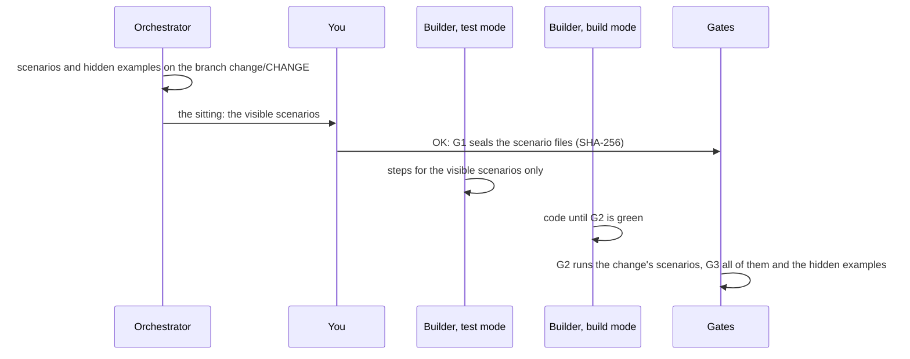

# Approve the scenarios

Use this page when the Orchestrator shows you the scenarios of a change. Scenarios are the
contract of the change: short examples that say what must happen, written in Gherkin, a plain
format of `Given`, `When` and `Then` lines. You read them, ask for changes in plain words, and
approve them at the Scenario Gate (G1). Your OK seals them, so no agent can quietly change
what you approved.

<!-- The chat excerpts and the sitting screens up to the confirmation come from one real run of
gdd 0.1.1 (main at 30b50c4) on 2026-10-31 with Claude Code and Codex: the run of the tutorial.
The Recorded screen, the G1 refusal and the sealed-file message were reproduced the same day
with gdd 0.1.1 in a throwaway copy of that project, with the same scenario files, without
agents and without a launch. -->

## Before you start

- A change the Orchestrator is preparing: see [Describe a change to your
  agent](run-a-change.md).
- Your project's quality bar for scenarios, if it has one, in `docs/standards.md` (gdd's
  [own](../standards.md) is an example).

The examples use the change `cart-total` of `shop`, a small online shop.

## How scenarios move through a change

Read the diagram top to bottom: who writes each file, who sees it and which gate runs it.



## 1. Read what the Orchestrator shows you

After it creates the change, the Orchestrator holds one [sitting](../glossary.md#sitting) with
you: a single message with everything that needs your approval. That is the scenarios as plain
text, the red zones when they wait, and the plan when the change is red. For `cart-total`, the
agent wrote:

```text
I've set up the change **cart-total** and written its scenarios. It's classified **yellow**:
ordinary code outside your protected zones. So there's no plan for you to approve now; you
approve the scenarios now and the finished result at the end.

**The scenarios to approve (G1)**

*A cart with several pieces shows its total, taxes included*
- The catalogue has a Blue mug at 18.00 and a Large bowl at 24.50.
- The customer puts 2 Blue mugs and 1 Large bowl in the cart.
- The cart shows a subtotal of **60.50**, tax of **12.71** and a total of **73.21**.

*An empty cart costs nothing*
- Subtotal **0.00**, tax **0.00**, total **0.00**.

I also wrote two hidden examples that the Builder doesn't see, to catch a wrong rounding rule or
a piece added twice.

**Two rules I built into these numbers. Please confirm or correct them:**
1. **Tax rate: 21% on everything.** That's the Spanish standard VAT rate, but it's only my
   example; tell me your real rate if it's different.
2. **Catalogue prices are before tax.** The shop adds the tax once, on the whole cart, and
   rounds to the cent (half a cent rounds up). The alternative is that the prices you list
   already include tax and the cart shows the tax inside them; in that case I'll redo the
   examples.

**Next step:** reply "scenarios OK", or give me your rate and price rule, and I'll seal the
scenarios and launch the build.
```

The agent retells the scenarios in plain words and adds the rules it needs you to confirm. It
committed the scenario file on the change's branch before it wrote this message, so the file
you would approve already exists (step 4 shows it on a screen). It reads:

```gherkin
Feature: Cart total with taxes
  A customer sees what the cart costs before tax, the tax, and the total to pay.
  Catalogue prices are before tax; the tax rate is 21% on the whole cart,
  rounded to the nearest cent (half a cent rounds up).

  Scenario: A cart with several pieces shows its total, taxes included
    Given the catalogue has these pieces:
      | piece           | price |
      | Blue mug        | 18.00 |
      | Large bowl      | 24.50 |
    And the customer puts 2 "Blue mug" in the cart
    And the customer puts 1 "Large bowl" in the cart
    When the customer looks at the cart total
    Then the subtotal is 60.50
    And the tax is 12.71
    And the total is 73.21

  Scenario: An empty cart costs nothing
    Given the catalogue has these pieces:
      | piece           | price |
      | Blue mug        | 18.00 |
    When the customer looks at the cart total
    Then the subtotal is 0.00
    And the tax is 0.00
    And the total is 0.00
```

- `Feature` names the behavior, and the lines under it say what it is for. Here they also state
  the rules: prices before tax, 21% on the whole cart, half a cent rounds up.
- Each `Scenario` is one example. `Given` is the starting point, `When` what someone does,
  `Then` what must be true afterwards. `And` continues the line before it. A table under a
  `Given` gives the data of one step, here the pieces of the cart.

Check these five things:

- **It is what you asked for.** Every case you care about has a scenario, and nothing is there
  that you did not want.
- **The words are the domain's.** Carts, pieces, prices and taxes, never functions, files or
  classes of the code. The Builder decides how a step reaches the code.
- **Every `Then` can fail.** `the total is 73.21` names one exact amount. A `Then` that cannot
  fail promises nothing.
- **Concrete examples, few scenarios.** Real prices show the edge cases better than a sentence
  about them: 21% of 60.50 is 12.705, so the example also fixes how the cent rounds.
- **The starting point is complete.** Everything the behavior depends on is in a `Given`, or in
  a `Background` that every scenario of the file shares, not assumed. Here the catalogue and its
  prices are in a `Given`, but the 21% rate is only in the description: the code takes it from
  the project. That is fine while the shop has one rate; if it may change, ask for a step such
  as `Given the tax rate is 21%`.

Only a few scenarios go through the user interface, tagged `@ui`. The others talk to the core
of the application, which is faster and less brittle; the demo in pre checks the real
interface.

## 2. Ask for changes in plain words

Say what is missing or wrong, as you would to a colleague. For example:

```text
My prices already include tax: show how much of the total is tax.
Add a cart with three plates of the same kind, so I see a quantity above one.
```

The Orchestrator rewrites the scenarios on the change's branch and shows them again. Nothing is
recorded until you say OK, so ask as many times as you need. A scenario you approve is hard to
change later: it is cheaper to fix it now than after the build.

## 3. Know what the hidden examples are

Hidden examples check that the code does what the scenarios say, not only what their data
shows. Next to the scenarios you read, the Orchestrator writes one or two of them in
`features/hidden/`, and the Builder never gets them. The Orchestrator does not show them in the
chat; the sitting screen does, marked as hidden (see step 4). One of `cart-total`'s:

```gherkin
Feature: Cart total with taxes (hidden examples)

  Scenario: Tax on the whole cart rounds down when under half a cent
    Given the catalogue has these pieces:
      | piece           | price |
      | Dinner plate    | 15.99 |
    And the customer puts 3 "Dinner plate" in the cart
    When the customer looks at the cart total
    Then the subtotal is 47.97
    And the tax is 10.07
    And the total is 58.04
```

A hidden example reuses the sentences of the visible scenarios with new data. The Builder in
test mode writes one step per visible sentence, so it could never write a sentence that only a
hidden example has. G1 refuses such an example and names the sentences. A hidden gift card
with two sentences of its own, for example:

```text
error: G1 refused: hidden examples use step phrasings that no visible scenario has, so test mode can never write them. Reuse visible sentences with new data:
  - no tax is charged on the gift card
  - the cart holds a gift card worth #
```

The Orchestrator then rewrites the hidden example, or adds the sentence to a visible scenario
for you to approve.

> [!NOTE]
> A hidden example is hidden from the agents' instructions, not locked away: a Builder that
> searches the project can read it. If a Builder reports that it read them, the Orchestrator writes fresh
> hidden examples before G4 and runs them, and you decide at G4 with that result
> ([`GDD.md`](../../GDD.md)).

## 4. Approve

In the chat, say OK, with the answers to any question the Orchestrator asked:

```text
scenarios OK. 21% is my rate and my prices are before tax.
```

The Orchestrator records G1 with your words, plus the red zones and the plan when they were part
of the sitting. G1 seals the scenario files as the last commit of the change's branch has them.
Then it launches the change. The agent answers:

```text
Your answers are recorded and the build is running in the background:

- **Scenarios approved (G1):** sealed with your rule: 21% tax on the whole cart, catalogue
  prices before tax, and half a cent rounds up.
...
```

To read everything on a screen first, hidden examples included, use the sitting screen. It
reads the scenarios from the change's branch, where the Orchestrator commits them before it
shows them in the chat. If you open it before that commit, it says `No scenarios on
change/cart-total yet: they show here once your agent commits them`. Open the sitting in a
terminal:

```bash
gdd sitting cart-total
```

You should see:

```text
┌ gdd · Sitting · shop ────────────────────────────────────────────────────────────────────────────┐
│cart-total · Show the cart total, taxes included · yellow                                         │
│                                                                                                  │
│Scenarios                                                                                         │
│features/cart_total.feature                                                                       │
│Feature: Cart total with taxes                                                                    │
│  A customer sees what the cart costs before tax, the tax, and the total to pay.                  │
│  Catalogue prices are before tax; the tax rate is 21% on the whole cart,                         │
│  rounded to the nearest cent (half a cent rounds up).                                            │
│                                                                                                  │
│  Scenario: A cart with several pieces shows its total, taxes included                            │
│    Given the catalogue has these pieces:                                                         │
...
│↑↓ scroll · a approve · c ask for changes · q quit                                                │
└──────────────────────────────────────────────────────────────────────────────────────────────────┘
```

The arrow keys scroll to the hidden examples, then to the red zones and the plan (blank lines
trimmed):

```text
┌ gdd · Sitting · shop ────────────────────────────────────────────────────────────────────────────┐
│features/hidden/cart_total_hidden.feature · hidden: the Builders never see it                     │
│Feature: Cart total with taxes (hidden examples)                                                  │
│  Scenario: Tax on the whole cart rounds down when under half a cent                              │
│    Given the catalogue has these pieces:                                                         │
...
│Red zones: approved                                                                               │
│Plan: not needed for a yellow change                                                              │
│↑↓ scroll · a approve · c ask for changes · q quit                                                │
└──────────────────────────────────────────────────────────────────────────────────────────────────┘
```

`Red zones: approved` means they were signed at the Setup; when they wait, the sitting lists
them under `Red zones to approve` and your approval covers them too. `a` approves and `c` asks
for changes: type what to change, then `Enter`. Both show first exactly what they will record,
as you, and nothing is written before `y`:

```text
┌ gdd · Sitting · shop ────────────────────────────────────────────────────────────────────────────┐
│This records, as you:                                                                             │
│- G1 ok on cart-total, sealing features/cart_total.feature,                                       │
│features/hidden/cart_total_hidden.feature                                                         │
│y to record · n to go back                                                                        │
│↑↓ scroll · q quit                                                                                │
└──────────────────────────────────────────────────────────────────────────────────────────────────┘
```

After `y`:

```text
┌ gdd · Sitting · shop ────────────────────────────────────────────────────────────────────────────┐
│Recorded                                                                                          │
│G1 ok on cart-total (human).                                                                      │
│Next: tell your agent it is approved (it runs gdd launch cart-total)                              │
│↑↓ scroll · q quit                                                                                │
└──────────────────────────────────────────────────────────────────────────────────────────────────┘
```

Then tell the Orchestrator in the chat that you approved, so it goes on to the launch. Every
key of the sitting is in [Screens](../reference/screens.md).

Only a person approves G1. A Builder or a Reviewer that tries is refused with
`A Builder or Reviewer cannot open or close gates.`

## 5. Change a scenario after its approval

Sealed files are compared at every gate. Your OK keeps a fingerprint of every scenario file of
the change, hidden examples included, in the change's record. From then on,
[Path Guard](../glossary.md#path-guard) compares each sealed file with its fingerprint at every
gate. If a file differs, whoever edited it, the gate fails:

```text
{"ok":false,"failures":["features/cart_total.feature: scenario approved in G1 and modified afterwards"]}
```

No Builder round can fix that, so such a change parks. An approved scenario changes only
through a new G1. If a scenario must change, tell the Orchestrator what to change. It edits the
scenario on the change's branch and holds the sitting again. Your new OK records a new G1, whose
fingerprints replace the old ones, so the next gate checks the new version. If the change is
parked, read [Get a parked change going again](parked-change.md) first.

A Hotfix's regression scenario, in `features/regression/`, needs no sitting: it checks a bug
fix, behavior that was already approved. It runs in G3 with all the others.

## Write scenarios yourself

You can write the scenarios and the Orchestrator still holds the sitting. Write them on the
change's branch, never on `main`, commit, and go back to `main`:

```bash
git switch change/cart-total
# write features/cart_total.feature and features/hidden/cart_total.feature
git add features/cart_total.feature features/hidden/cart_total.feature
git commit -m "cart-total: scenarios"
git switch main
```

Commit before you approve: G1 seals the files as the last commit of the branch has them, and
an edit left uncommitted is not sealed. Three more rules:

- **Hidden examples reuse visible sentences** with new data. G1 compares the sentences with
  their data blanked: quoted text, numbers and outline placeholders (`<name>`) count as data;
  tables and doc strings are left out.
- **Tag hidden files `@hidden`.** The TypeScript sheet's G2 skips `@hidden` scenarios; the Rust
  and Python sheets leave out `features/hidden/` by folder and run it only in G3, with
  `GDD_HIDDEN=1`. The tag does no harm there.
- **Set the configuration a behavior depends on in the `Background`.** When the behavior
  depends on configuration, the `Background` sets it, so the scenario does not depend on what
  the project has today. gdd's own scenarios do it in every feature:

  ```gherkin
  Background:
    Given a GDD project in a git repository with the protected paths:
      """
      [protected]
      all = ["gdd/**", "bin/**"]
      """
    And the zone map:
      """
      default = "yellow"
      """
  ```

  Put any change to protected configuration before the step that starts the build. Written
  after it, Path Guard rightly blames the Builder, and no Builder round can fix that.

## Under the hood

Approving runs [`gdd gate G1 ok CHANGE --by human`](../reference/cli/gate.md) from the change's
branch, plus `gdd gate zones ok` and `gdd gate plan ok` when they wait; asking for changes on
the screen runs `gdd gate G1 ko` with your words. [`gdd sitting`](../reference/cli/sitting.md)
records the same, and without a terminal it says which `gdd gate` lines to run instead. After
G1, the Builder in test mode writes one step per sentence and checks that each fails for the
right reason; build mode cannot touch the `.feature` files or the steps (`builder_build` and
`builder_test` in `gdd/rules.toml`). The runner runs in strict mode, so a sentence without a
step fails. G2 runs the change's scenario files (`GDD_FEATURES`); G3 runs all of them, hidden
examples included.

## Next steps

- [Describe a change to your agent](run-a-change.md): what happens once you approve.
- [Review a change at G4](release-gate.md): you meet this change again at the Release Gate.
- [Keeping agents honest](../explanation/safety.md): why the hashes, the hidden examples and
  Path Guard work together.
- [The change skill](../reference/skills/change.md): how the Orchestrator writes and records
  the scenarios.
