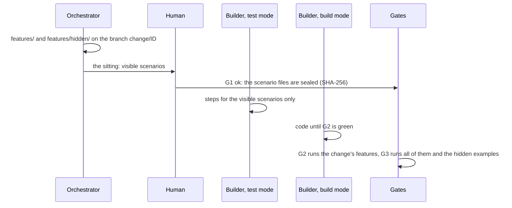

# Write and approve scenarios

Scenarios are the contract of a change: Gherkin sentences in `features/` that say what must
happen. This page shows how to write good ones, how to add hidden examples and how to approve
them at the Scenario Gate (G1), which seals them so no agent can change them afterwards.

## Before you start

- A GDD project whose Setup is done (`bin/gdd status` says `G0: ok`). See
  [Your first change](../getting-started/tutorial.md).
- A change that plans its `.feature` file. See [Run a change](run-a-change.md).
- The quality bar of your project for scenarios, in [`docs/standards.md`](../standards.md) (gdd's
  own is an example).

The examples below build the change `export-csv` of a command-line notes tool, `notes`, on the
Rust stack. Every command runs from the project root, in the main checkout.

## How scenarios move through a change

Read the diagram top to bottom: who writes each file, who sees it and which gate runs it.



## 1. Plan the scenario file in the change

Name the `.feature` file in `--paths` when you create the change, so gdd knows the change needs
G1:

```bash
bin/gdd new-change export-csv --title "Export notes as CSV" --paths src/export.rs features/export_csv.feature
```

You should see, among the classification:

```text
  "color": "yellow",
  "lane": "full",
  ...
  "g1": true,
  "features": [
    "features/export_csv.feature"
  ],
  ...
  "g4": true,
```

`"g1": true` means a human approves the scenarios before the build, and `"g4": true` means the
same human meets the change again at the [Release Gate](release-gate.md): with the default rules
table, a change with new scenarios stops at G4. A change that touches a `.feature` file it did
not plan gets the same gates: gdd also counts the paths the change really touched.

## 2. Write the scenarios on the change's branch

The scenarios live on the branch `change/<id>`, never on main, until the change merges:

```bash
git switch change/export-csv
```

Write `features/export_csv.feature`:

```gherkin
Feature: Export notes as CSV
  `notes export --csv` writes the notes as CSV, one row per note under a header, so they open
  in a spreadsheet. Private notes stay out unless the user asks for them.

  Background:
    Given a notebook with the notes:
      | title         | tags | written    | private |
      | Groceries     | home | 2026-10-01 | no      |
      | Rent, October | home | 2026-10-03 | no      |
      | Salary review | work | 2026-10-12 | yes     |

  Scenario: Every public note becomes one row
    When I export the notebook as CSV
    Then the CSV is:
      """
      title,tags,written
      Groceries,home,2026-10-01
      "Rent, October",home,2026-10-03
      """
    And the CSV leaves out "Salary review"

  Scenario: Private notes join the export only when asked for
    When I export the notebook as CSV with private notes
    Then row 3 of the CSV starts with "Salary review"
```

What makes these scenarios good:

- **The steps speak the language of the domain.** Notebooks, notes and exports, never functions,
  files or flags of the implementation. The Builder decides how a step reaches the code.
- **Every `Then` can fail.** `the CSV is:` compares the whole output, and `leaves out` names the
  note that must be missing. A step that cannot fail is a bug, as
  [`docs/standards.md`](../standards.md) says.
- **Concrete examples, few scenarios.** Real titles and dates show the edge cases (a comma inside
  a title) better than a sentence about them.
- **The Background states everything the behaviour depends on.** Here it is the notebook. For a
  behaviour that depends on configuration, such as the rules table or the zone map, the
  Background sets that configuration, so the scenario does not depend on whatever the project
  has today. gdd's own scenarios do it in every feature:

  ```gherkin
  Background:
    Given a GDD project in a git repository with the protected paths:
      """
      [protected]
      all = ["gdd/**", "bin/**"]
      """
    And the zone map:
      """
      default = "yellow"
      """
  ```

  Any change to protected configuration goes before the step that starts the build. Written
  after it, Path Guard rightly blames the Builder, and no Builder round can fix that.

Only a few scenarios go through the user interface, tagged `@ui`. By default the steps talk to
the core of the application, which is faster and less brittle; the pre demo checks the real
interface.

## 3. Add hidden examples

A hidden example is a scenario in `features/hidden/` that the Builder never gets: it checks that
the code does what the scenarios say, not only what their data shows. Write
`features/hidden/export_csv.feature`:

```gherkin
@hidden
Feature: Hidden examples for exporting notes as CSV

  Scenario: Private notes stay out, with other notes
    Given a notebook with the notes:
      | title     | tags   | written    | private |
      | Dentist   | health | 2026-09-30 | yes     |
      | Book club | fun    | 2026-10-20 | no      |
    When I export the notebook as CSV
    Then the CSV is:
      """
      title,tags,written
      Book club,fun,2026-10-20
      """
    And the CSV leaves out "Dentist"
```

Hidden examples reuse the sentences of the visible scenarios with new data. Test mode never sees
them, so it can only write their steps if their sentences are already in a visible scenario.
G1 compares the sentences with their data blanked: quoted text, numbers and outline
placeholders (`<name>`) count as data; tables and doc strings are left out. A sentence no visible
scenario has makes G1 refuse. Add this scenario to the hidden file:

```gherkin
  Scenario: A note without tags
    Given a notebook with one note "Call mum" and no tags
    When I export the notebook as CSV
    Then the tags field of row 1 is empty
```

and G1 names the two sentences test mode could never write:

```text
error: G1 refused: hidden examples use step phrasings that no visible scenario has, so test mode can never write them. Reuse visible sentences with new data:
  - a notebook with one note "…" and no tags
  - the tags field of row # is empty
```

The `@hidden` tag matters on the TypeScript stack: its G2 command skips `@hidden` scenarios. The
Rust and Python sheets leave out `features/hidden/` by folder, and run it only in G3, with
`GDD_HIDDEN=1`. The tag does no harm there.

> [!NOTE]
> A hidden example is hidden from the agents' instructions, not locked away: a Builder that goes
> looking can read it. If a Builder reports that it read them, the Orchestrator writes fresh
> hidden examples before G4 and runs them, and you decide at G4 with that result
> ([`GDD.md`](../../GDD.md)).

## 4. Commit and go back to main

```bash
git add features/export_csv.feature features/hidden/export_csv.feature
git commit -m "export-csv: scenarios"
git switch main
```

Commit before you approve. Approved from main, G1 seals the files as the last commit of the
branch has them; an edit you did not commit is not sealed, and Path Guard then sees it as a
change to an approved scenario.

## 5. Approve them at the sitting

The sitting is one screen per change with everything that needs you before the build: the
scenarios as the branch has them, the hidden examples (marked `hidden: the Builders never see
it`), the red zones waiting for approval with their reasons, and the plan of a red change.

```bash
bin/gdd sitting export-csv
```

| Key | What it does |
|---|---|
| `↑` `↓` | Scroll |
| `a` | Approve: shows exactly what it will record, as you |
| `c` | Ask for changes: type what to change, then `Enter`; records G1 KO with your words |
| `y` / `n` | Record what the confirmation shows, or go back without recording |
| `q` | Quit; nothing was written |

Approving records G1 from the change's branch (sealing its scenario files), the red zones when
they wait, and the plan of a red change. The sitting ends with `Next: gdd launch export-csv`.
Nothing is written before `y`.

Without a terminal (from a script, or an agent's chat), the sitting says what to run instead:

```text
error: gdd sitting needs a terminal; without one, record the sitting with gdd gate G1 ok export-csv --by human (and gdd gate zones ok --by human, gdd gate plan ok export-csv --by human for a red change)
```

```bash
bin/gdd gate G1 ok export-csv --by human --note "Two scenarios, one hidden example"
```

You should see:

```text
G1 ok on export-csv (human).
```

To ask for changes instead, record G1 KO with what must change:

```bash
bin/gdd gate G1 ko export-csv --by human --note "Say what happens to a note without tags"
```

Only a human approves G1: a Builder or a Reviewer that runs `gdd gate` is refused with `A
Builder or Reviewer cannot open or close gates.`

## 6. Check what G1 sealed

The record of the change keeps the SHA-256 of every scenario file it sealed, hidden examples
included. In `.gdd/changes/export-csv/change.json`:

```json
"G1": {
  "by": "human",
  "decision": "ok",
  "hashes": {
    "features/export_csv.feature": "0658d1978f1549c0b2a63c08b60b698c734f55206bef27a73c575aa868171fe3",
    "features/hidden/export_csv.feature": "4cf81ea487a1ada4601534eb5aa7980c752f1e75888fa3eb9e681b1c10ec4f65"
  },
  "note": "Two scenarios, one hidden example",
  "ts": "2026-10-30T13:15:22+00:00"
}
```

`bin/gdd status` lists the change with `G1:ok`. Now launch it: `bin/gdd launch export-csv` (see
[Run a change](run-a-change.md)).

## 7. Let the Builder write the steps

The first agent of the launch is the Builder in test mode. It gets a context package with the
visible scenarios, never the hidden ones, and:

- writes one step definition per sentence, against the domain language, with real assertions;
- reuses a step that already says the same, and adds a general one (values as parameters) only
  when none fits;
- drives each step at the lowest layer that shows the behaviour: a domain function, then the
  command line, then the screen;
- checks with `bin/gdd g2 --role builder-test` that the new tests fail because the behaviour is
  missing, not because of a syntax or setup error.

Test mode cannot write production code, and build mode, which comes next, cannot touch the
`.feature` files or the steps: both are protected paths in `gdd/rules.toml` (`builder_test` and
`builder_build`). The runner of every stack sheet runs in **strict mode**: a sentence without a
step, or a pending step, fails the run, so a scenario cannot pass by being skipped.

Each gate runs a different set:

| Gate | Runs | How it knows |
|---|---|---|
| G2, every Builder round | the change's scenario files | `GDD_FEATURES`, one path per line; empty means all of them |
| G3, before the merge | every scenario, hidden examples included | `GDD_FEATURES` empty and `GDD_HIDDEN=1` in the Rust and Python sheets; no tag filter in TypeScript |

## 8. Change a scenario after its approval

Path Guard stops anyone who changes a sealed file, whatever their role. Edit
`features/export_csv.feature` on the branch, and the next gate says:

```text
{"ok":false,"failures":["features/export_csv.feature: scenario approved in G1 and modified afterwards"]}
```

No Builder round can fix that, so a change with a modified approved scenario parks. When the
scenario itself must change, it is your decision: edit it on the branch, commit, and approve G1
again. The new approval seals the new hashes:

```bash
git switch change/export-csv
# edit features/export_csv.feature
git commit -am "export-csv: clearer scenario title"
bin/gdd gate G1 ok export-csv --by human --note "Reworded one title"
git switch main
```

You should see `G1 ok on export-csv (human).`, and Path Guard passes again. If the change is
parked, read [Get a parked change going again](parked-change.md) before you commit anything on
its branch.

## Regression scenarios: no G1

A scenario in `features/regression/` pins down a bug that was fixed. It describes behaviour that
was already approved, so it needs no sitting:

```bash
bin/gdd new-change empty-title --type Hotfix --title "An empty title no longer breaks the export" --paths src/export.rs features/regression/empty_title.feature
```

You should see:

```text
  "g1": false,
  "features": [],
```

The folder is `regression` in `[acceptance]` of `gdd/rules.toml`. Regression scenarios run in
G3 with all the others, and they do not make a change leave the fast lane.

## Next steps

- [Run a change](run-a-change.md): launch the change you just approved and follow it.
- [Answer the Release Gate](release-gate.md): you meet this change again at G4.
- [Keeping agents honest](../explanation/safety.md): why the hashes, the hidden examples and Path
  Guard work together.
- [Command reference: gdd gate](../reference/cli.md#gdd-gate): every gate and option.
