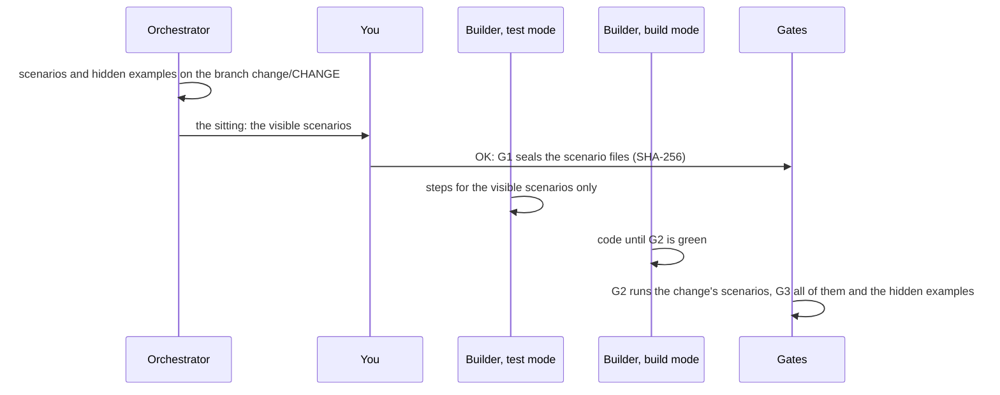

# Approve the scenarios

Use this page when the Orchestrator shows you the scenarios of a change. Scenarios are the
contract of the change: short examples that say what must happen, written in Gherkin, a plain
format of `Given`, `When` and `Then` lines. You read them, ask for changes in plain words, and
approve them at the Scenario Gate (G1). Your OK seals them, so no agent can quietly change
what you approved.

<!-- The chat excerpts come from one real run of gdd 0.1.0 (main at e244577) on 2026-10-31 with
Claude Code: the run of the tutorial. The sitting screens with the scenarios, the G1 refusal and
the sealed-file message were reproduced the same day in throwaway copies of that project, with
the same scenario files, without agents and without a launch. -->

## Before you start

- A change the Orchestrator is preparing: see [Describe a change to your
  agent](run-a-change.md).
- Your project's quality bar for scenarios, if it has one, in `docs/standards.md` (gdd's
  [own](../standards.md) is an example).

The examples use the change `cart-total` of `shop`, a small online shop.

## How scenarios move through a change

Read the diagram top to bottom: who writes each file, who sees it and which gate runs it.



## 1. Read what the Orchestrator shows you

After it creates the change, the Orchestrator holds one [sitting](../glossary.md#sitting) with
you: a single message with everything that needs your approval. That is the scenarios as plain
text, the red zones when they wait, and the plan when the change is red. For `cart-total`, the
agent wrote:

```text
**The scenarios** (all prices are set by you, tax already included):

> **Background:** the tax rate is 21%
>
> **1. The total adds up every piece in the cart**
> A cart with 1 × Blue mug at 24.20 and 2 × Wide bowl at 36.30.
> The total is **96.80**, and the tax included in it is **16.80**.
>
> **2. The tax is rounded to the cent**
> A cart with 1 × Small cup at 25.00.
> The total is **25.00**, and the tax included in it is **4.34**.
>
> **3. An empty cart costs nothing**
> The total is **0.00**, and the tax included is **0.00**.

I also wrote two hidden examples that the Builder won't see, to check it implemented the rule
and didn't just match the visible numbers.

**Questions:**
1. **Do your prices already include tax?** I recommend yes: ...
2. **Which tax rate, and which currency?** I used 21% as a placeholder (Spain's VAT rate) and
   left out the currency. Tell me your rate and currency and I'll put them in.
3. **Rounding:** I recommend working out the tax once on the cart total, rounded to the nearest
   cent. ...

**Next step:** reply "OK" if all my recommendations stand, or give your rate, currency and any
corrections. I'll then commit the scenarios, approve G1 with your note, and launch the build.
```

The agent retells the scenarios in plain words and adds its questions. The scenario file behind
it reads:

```gherkin
Feature: Cart total, taxes included
  The customer sees what the cart costs in total, taxes included,
  and how much of that total is tax.
  Prices are set by the seller with tax already included.

  Background:
    Given the tax rate is 21%

  Scenario: The total adds up every piece in the cart
    Given a cart with
      | piece     | price | quantity |
      | Blue mug  | 24.20 | 1        |
      | Wide bowl | 36.30 | 2        |
    When the customer looks at the cart
    Then the total is 96.80
    And the tax included in the total is 16.80

  Scenario: The tax is rounded to the cent
    Given a cart with
      | piece     | price | quantity |
      | Small cup | 25.00 | 1        |
    When the customer looks at the cart
    Then the total is 25.00
    And the tax included in the total is 4.34

  Scenario: An empty cart costs nothing
    Given an empty cart
    When the customer looks at the cart
    Then the total is 0.00
    And the tax included in the total is 0.00
```

- `Feature` names the behavior, and the lines under it say what it is for.
- `Background` sets the starting point every scenario of the file shares: here, the tax rate.
- Each `Scenario` is one example. `Given` is the starting point, `When` what someone does,
  `Then` what must be true afterwards. `And` continues the line before it. A table under a
  `Given` gives the data of one step, here the pieces of the cart.

Check these five things:

- **It is what you asked for.** Every case you care about has a scenario, and nothing is there
  that you did not want.
- **The words are the domain's.** Carts, pieces, prices and taxes, never functions, files or
  classes of the code. The Builder decides how a step reaches the code.
- **Every `Then` can fail.** `the total is 96.80` names one exact amount. A `Then` that cannot
  fail promises nothing.
- **Concrete examples, few scenarios.** Real prices show the edge cases better than a sentence
  about them: the tax included in 25.00 at 21% is 4.338..., so the example also fixes how the
  cent rounds.
- **The starting point is complete.** Everything the behavior depends on is in a `Given` or the
  `Background`, not assumed: here the tax rate is set, not taken from the project.

Only a few scenarios go through the user interface, tagged `@ui`. The others talk to the core
of the application, which is faster and less brittle; the demo in pre checks the real
interface.

## 2. Ask for changes in plain words

Say what is missing or wrong, as you would to a colleague. For example:

```text
My prices are without tax: add the tax on top, and show the subtotal too.
Add a cart with three plates of the same kind, so I see a quantity above one.
```

The Orchestrator rewrites the scenarios on the change's branch and shows them again. Nothing is
recorded until you say OK, so ask as many times as you need. A scenario you approve is hard to
change later: it is cheaper to fix it now than after the build.

## 3. Know what the hidden examples are

Hidden examples check that the code does what the scenarios say, not only what their data
shows. Next to the scenarios you read, the Orchestrator writes one or two of them in
`features/hidden/`, and the Builder never gets them. The Orchestrator does not show them in the
chat; the sitting screen does, marked as hidden (see step 4). One of `cart-total`'s:

```gherkin
Feature: Cart total, taxes included (hidden examples)

  Background:
    Given the tax rate is 21%

  Scenario: Several plates of the same kind
    Given a cart with
      | piece        | price | quantity |
      | Dinner plate | 18.15 | 3        |
    When the customer looks at the cart
    Then the total is 54.45
    And the tax included in the total is 9.45
```

A hidden example reuses the sentences of the visible scenarios with new data. The Builder in
test mode writes one step per visible sentence, so it could never write a sentence that only a
hidden example has. G1 refuses such an example and names the sentences. A hidden gift card
with two sentences of its own, for example:

```text
error: G1 refused: hidden examples use step phrasings that no visible scenario has, so test mode can never write them. Reuse visible sentences with new data:
  - no tax is charged on the gift card
  - the cart holds a gift card worth #
```

The Orchestrator then rewrites the hidden example, or adds the sentence to a visible scenario
for you to approve.

> [!NOTE]
> A hidden example is hidden from the agents' instructions, not locked away: a Builder that
> searches the project can read it. If a Builder reports that it read them, the Orchestrator writes fresh
> hidden examples before G4 and runs them, and you decide at G4 with that result
> ([`GDD.md`](../../GDD.md)).

## 4. Approve

In the chat, say OK, with the answers to any question the Orchestrator asked:

```text
OK, as they are. My prices include tax, 21% is my rate and I sell in euros.
```

The Orchestrator commits the scenarios on the change's branch and records G1 with your words,
plus the red zones and the plan when they were part of the sitting. Then it launches the
change. The agent answers:

```text
The **cart-total** change is now building on its own. I'll get a notification when it finishes
or stops.

**Approved and recorded:**
- G1, with your note: prices include tax, the rate is 21%, amounts are in euros, and the tax is
  worked out once on the cart total.
...
```

To read everything on a screen first, hidden examples included, use the sitting screen. It
reads the scenarios from the change's branch, and the Orchestrator commits them there only
after your OK. Until then the screen says `No scenario files on change/cart-total`, so ask the
agent to commit the scenarios first. Then open the sitting in a terminal:

```bash
gdd sitting cart-total
```

With the files committed, you should see:

```text
┌ gdd · Sitting · shop ────────────────────────────────────────────────────────────────────────────┐
│cart-total · Show the cart total, taxes included · yellow                                         │
│                                                                                                  │
│Scenarios                                                                                         │
│features/cart_total.feature                                                                       │
│Feature: Cart total, taxes included                                                               │
│  The customer sees what the cart costs in total, taxes included,                                 │
│  and how much of that total is tax.                                                              │
│  Prices are set by the seller with tax already included.                                         │
│                                                                                                  │
│  Background:                                                                                     │
│    Given the tax rate is 21%                                                                     │
│                                                                                                  │
│  Scenario: The total adds up every piece in the cart                                             │
│    Given a cart with                                                                             │
...
│↑↓ scroll · a approve · c ask for changes · q quit                                                │
└──────────────────────────────────────────────────────────────────────────────────────────────────┘
```

The arrow keys scroll to the hidden examples, then to the red zones and the plan (blank lines
trimmed):

```text
┌ gdd · Sitting · shop ────────────────────────────────────────────────────────────────────────────┐
│features/hidden/cart_total.feature · hidden: the Builders never see it                            │
│Feature: Cart total, taxes included (hidden examples)                                             │
│  Background:                                                                                     │
│    Given the tax rate is 21%                                                                     │
│  Scenario: Several plates of the same kind                                                       │
...
│Red zones: approved                                                                               │
│Plan: not needed for a yellow change                                                              │
│↑↓ scroll · a approve · c ask for changes · q quit                                                │
└──────────────────────────────────────────────────────────────────────────────────────────────────┘
```

`Red zones: approved` means they were signed at the Setup; when they wait, the sitting lists
them under `Red zones to approve` and your approval covers them too. `a` approves and `c` asks
for changes: type what to change, then `Enter`. Both show first exactly what they will record,
as you, and nothing is written before `y`:

```text
┌ gdd · Sitting · shop ────────────────────────────────────────────────────────────────────────────┐
│This records, as you:                                                                             │
│- G1 ok on cart-total, sealing features/cart_total.feature, features/hidden/cart_total.feature    │
│y to record · n to go back                                                                        │
│↑↓ scroll · q quit                                                                                │
└──────────────────────────────────────────────────────────────────────────────────────────────────┘
```

After `y`:

```text
┌ gdd · Sitting · shop ────────────────────────────────────────────────────────────────────────────┐
│Recorded                                                                                          │
│G1 ok on cart-total (human).                                                                      │
│Next: tell your agent it is approved (it runs gdd launch cart-total)                              │
│↑↓ scroll · q quit                                                                                │
└──────────────────────────────────────────────────────────────────────────────────────────────────┘
```

Then tell the Orchestrator in the chat that you approved, so it goes on to the launch. Every
key of the sitting is in [Screens](../reference/screens.md).

Only a person approves G1. A Builder or a Reviewer that tries is refused with
`A Builder or Reviewer cannot open or close gates.`

## 5. Change a scenario after its approval

Sealed files are compared at every gate. Your OK keeps a fingerprint of every scenario file of
the change, hidden examples included, in the change's record. From then on,
[Path Guard](../glossary.md#path-guard) compares each sealed file with its fingerprint at every
gate. If a file differs, whoever edited it, the gate fails:

```text
{"ok":false,"failures":["features/cart_total.feature: scenario approved in G1 and modified afterwards"]}
```

No Builder round can fix that, so such a change parks. An approved scenario changes only
through a new G1. If a scenario must change, tell the Orchestrator what to change. It edits the
scenario on the change's branch and holds the sitting again. Your new OK records a new G1, whose
fingerprints replace the old ones, so the next gate checks the new version. If the change is
parked, read [Get a parked change going again](parked-change.md) first.

A Hotfix's regression scenario, in `features/regression/`, needs no sitting: it checks a bug
fix, behavior that was already approved. It runs in G3 with all the others.

## Write scenarios yourself

You can write the scenarios and the Orchestrator still holds the sitting. Write them on the
change's branch, never on `main`, commit, and go back to `main`:

```bash
git switch change/cart-total
# write features/cart_total.feature and features/hidden/cart_total.feature
git add features/cart_total.feature features/hidden/cart_total.feature
git commit -m "cart-total: scenarios"
git switch main
```

Commit before you approve: G1 seals the files as the last commit of the branch has them, and
an edit left uncommitted is not sealed. Three more rules:

- **Hidden examples reuse visible sentences** with new data. G1 compares the sentences with
  their data blanked: quoted text, numbers and outline placeholders (`<name>`) count as data;
  tables and doc strings are left out.
- **Tag hidden files `@hidden`.** The TypeScript sheet's G2 skips `@hidden` scenarios; the Rust
  and Python sheets leave out `features/hidden/` by folder and run it only in G3, with
  `GDD_HIDDEN=1`. The tag does no harm there.
- **Set the configuration a behavior depends on in the `Background`.** When the behavior
  depends on configuration, the `Background` sets it, so the scenario does not depend on what
  the project has today. gdd's own scenarios do it in every feature:

  ```gherkin
  Background:
    Given a GDD project in a git repository with the protected paths:
      """
      [protected]
      all = ["gdd/**", "bin/**"]
      """
    And the zone map:
      """
      default = "yellow"
      """
  ```

  Put any change to protected configuration before the step that starts the build. Written
  after it, Path Guard rightly blames the Builder, and no Builder round can fix that.

## Under the hood

Approving runs [`gdd gate G1 ok CHANGE --by human`](../reference/cli/gate.md) from the change's
branch, plus `gdd gate zones ok` and `gdd gate plan ok` when they wait; asking for changes on
the screen runs `gdd gate G1 ko` with your words. [`gdd sitting`](../reference/cli/sitting.md)
records the same, and without a terminal it says which `gdd gate` lines to run instead. After
G1, the Builder in test mode writes one step per sentence and checks that each fails for the
right reason; build mode cannot touch the `.feature` files or the steps (`builder_build` and
`builder_test` in `gdd/rules.toml`). The runner runs in strict mode, so a sentence without a
step fails. G2 runs the change's scenario files (`GDD_FEATURES`); G3 runs all of them, hidden
examples included.

## Next steps

- [Describe a change to your agent](run-a-change.md): what happens once you approve.
- [Review a change at G4](release-gate.md): you meet this change again at the Release Gate.
- [Keeping agents honest](../explanation/safety.md): why the hashes, the hidden examples and
  Path Guard work together.
- [The change skill](../reference/skills/change.md): how the Orchestrator writes and records
  the scenarios.
