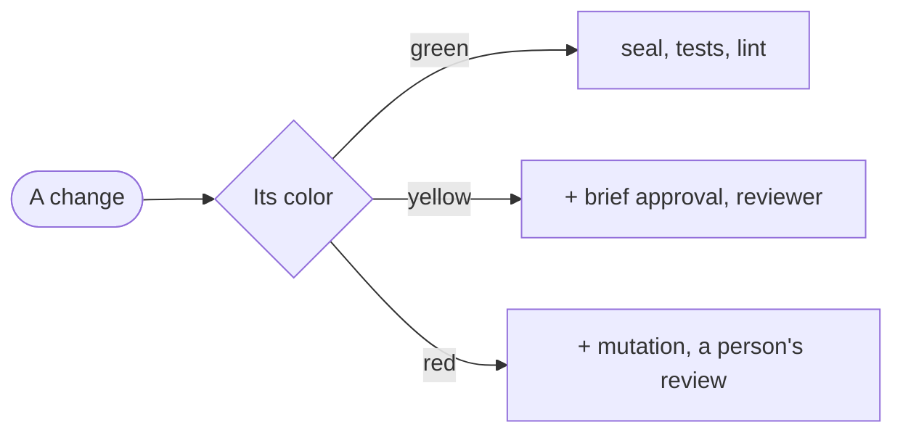

# The GDD contract

A gate is one thing a change has to demonstrate before it goes on, and its checks are what demonstrate it: the standing gates of a zone are the `Rule:`s of its file, and the gates of a change are its scenarios. What the method leaves in a repository is the contract between the skills and any engine, T-minus included: an engine reads and writes these same files (decision 13 in [DESIGN.md](DESIGN.md)). This file is its only source. Each skill carries a copy of the templates it writes in its `assets/` folder, and `scripts/check_skills.py`, in this repository, fails if a copy differs from its template here. That check is ours: no project installs it.

The version of the contract is `gdd/1`. It goes in the front matter of the blueprint and of each brief, and in every event of the log.

## The files

| File | What it holds | Who writes it | How it changes |
|---|---|---|---|
| `AGENTS.md`, GDD block | The cross-cutting core, under 100 words, and the map. It imports the constitution | `gdd-prepare` | With the person's approval |
| `gdd/constitution.md` | The stack, the commands and the rules that hold everywhere | `gdd-prepare` | With the person's approval |
| `gdd/blueprint.md` | Levels, limits, checks, colors, zones and the context of each gate, in YAML front matter, plus a Mermaid diagram | `gdd-prepare`, `gdd-harden` | Protected by CODEOWNERS; the person approves |
| `gdd/gates/<zone>.feature` | The standing gates of a zone, in Gherkin | `gdd-prepare`, `gdd-harden`, with the person | Like the blueprint |
| `gdd/exam.md` | The reviewer's exam: the changes that got past a reviewer, as commits of the main branch | `gdd-harden`, with the person | Like the blueprint |
| `gdd/backlog.md` | What to build, each item with its expected color | `gdd-prepare`, `gdd-brief`, `gdd`, `gdd-harden` | Freely |
| `gdd/debt.md` | Known debt, with the baseline of each check | `gdd-prepare`, and `gdd` when a person waives a check | Down freely; up only with the person's approval |
| `gdd/briefs/<id>.md` | What has to pass for one change, which the person approves when its color asks for `brief-approval` | `gdd-brief` | Never once its hashes are in the log: a change makes a new version (the same file, with `version` raised by one), which goes back to the person only if its color asks for `brief-approval` and what has to pass changes |
| `features/<capability>.feature` | The scenarios of changes, grouped by capability | `gdd-brief`, with the person | Only through a brief |
| `gdd/log/<id>.jsonl` | Everything that happens to a brief, one event per line | `gdd`, from what each role reports | Only appended |
| `gdd/context/` | Copies of external references and research | `gdd-prepare` | Refreshed with a new date |

## Rules for every file

- **Ids** use lowercase letters, digits and hyphens: zones, checks, briefs, backlog items and scenarios.
- **Paths** are git pathspecs from the root of the repository, with `:(glob)` for patterns, so `git diff --name-only <base> -- <pathspec>` gives the same answer to everyone.
- **Commits** have two names in these files. `<base>` is the commit of the main branch a change starts from, and the `brief` step records it in its `color`. `<start>` is the commit that holds everything that judges the change before anyone builds: the tip of its seal, written in the log by the step that last moved it, or the base when nothing was sealed, as on green.
- **Hashes** are git blob hashes (`git hash-object <file>`), so anyone can recompute them without a script.
- **Evidence** is a command, its exit code and its last lines, five at most: every line of it stays in the log and in the context of whoever reads it.
- **Approved files** are never edited by an agent: the blueprint and the gates change through a commit or pull request the person approves, and a brief, approved or not, changes only through a new version.
- **A green change** has no brief file, unless the blueprint's green asks for `brief-approval`. Its events go to `gdd/log/<id>.jsonl` like any other, with an id the orchestrator picks.
- **What isn't about one change** (approving the blueprint, its gates or its debt, preparing and hardening) goes to `gdd/log/blueprint.jsonl`, with `blueprint` as its `brief`.

## Where each thing is committed

Four things have to be true, however an engine gets there:

1. What judges a change (its brief, its scenarios and its checks) is committed before anyone builds, on `gdd-seal/<id>`, a branch cut from `<base>`. Its tip is `<start>`. When nothing was sealed, `<start>` is `<base>`.
2. The builder commits its work on a branch of its own that starts at `<start>`. Afterwards only the orchestrator adds to it: a new tip of the seal, merged in, and its bookkeeping.
3. Every comparison is made against the commit `<start>` written in the log, never against the name of a ref, which can be moved: the color on what was touched, the `seal` check and whether anything was built.
4. The log and the backlog are the orchestrator's bookkeeping. It keeps them in its own copy, outside every change's branch, so the builder never has the log, and commits what the main branch doesn't have yet on top of a change that is about to ship, before the person's review when its color has one. What it logs after that commit, the `ship` among it, travels with the next change.

The seal moves forward with new commits: a new version of a brief, new checks for a color that rose, a corrected check, and the main branch merged into it before the change ships. Its new tip is the new `<start>`. The step that moved it writes it in the log (`brief`, `checks` and `gates` carry it), and it's merged into the change's branch before anyone goes on. With nothing sealed, the tip of the main branch is the new `<start>`. A conflict in the seal is settled by whoever wrote what conflicts: the orchestrator its briefs and scenarios, `gdd-checks` its checks.

The blueprint, the gates, the exam, the constitution and the debt never change inside a change: they go through a commit or a pull request of their own, which the person approves, and they are on the main branch before a change that needs them is briefed.

## The GDD block of AGENTS.md

`gdd-prepare` writes it between the two markers, so it can be replaced without touching the rest of `AGENTS.md`. If the project has a `CLAUDE.md`, it also adds a line `@AGENTS.md` to it, because Claude Code reads `AGENTS.md` only when there is no `CLAUDE.md`.

<!-- template: gdd-prepare/assets/agents-block.md -->
```markdown
<!-- gdd:begin -->
## GDD

This project uses Gate-Driven Development (contract gdd/1): a change is done when its gates pass, not when an agent says so.

- No role given? Load the `gdd` skill first.
- Edit only what your role owns: never a sealed check, and never `gdd/`, `features/` or the agents' own files (`AGENTS.md`, skills, settings) unless your role writes them.
- Get through gates with facts: the command, its exit code and its last lines.
- When something doesn't fit, stop and say why.

Map: `gdd/blueprint.md` zones and gates, `gdd/gates/` their scenarios, `gdd/briefs/` changes, `features/` their scenarios, `gdd/context/` references.

@gdd/constitution.md
<!-- gdd:end -->
```

## The constitution

<!-- template: gdd-prepare/assets/constitution.md -->
```markdown
# Constitution

What every agent needs at every gate and can't work out from the code. It goes into every call, so keep it short. A rule that matters in only one zone goes to that zone's context in the blueprint.

## Stack

- <languages, frameworks and their versions>

## Commands

Gates run these same commands, locally and in CI.

| What | Command |
|---|---|
| Install | `<command>` |
| Build | `<command>` |
| Test | `<command>` |
| Lint | `<command>` |

## How a change ships

<For example: a pull request to the main branch, which a person merges.>

## Rules that hold everywhere

- <for example: prices are stored in cents>
```

## The blueprint

The front matter is what agents read; the diagram and the table are for the person. Its fields:

- `guarantee`: how far out of the builder's reach the checks are: `rule`, `platform` or `engine`. The person sets it when preparing, after the probe.
- `levels`: which model the project uses for each level, by the name its agents' environment launches it with. The skills never name one.
- `limits`: fix rounds per gate, and the caps of a whole change. `fix_rounds_per_gate` is how many times the machine checks, and how many times the review, may send a change back to the builder, and `rounds_per_change` how many times it may be sent back in all, a `CANNOT:` and a color that rose included. Minutes count from the first event of its log, without the time it waits for a person (from an `ask` to the event that answers it). Lines are the builder's, `git diff --shortstat <start> HEAD`. The template's values are provisional, a place to start from: the team sets its own when preparing, and corrects them with what its logs show. The cap on tokens has no default, and applies only where the agents' environment reports them.
- `checks`: every check a gate can ask for, with its type (`machine`, `reviewer` or `person`) and, for machine checks, the exact command from the constitution. The command of `seal` is the same in every project, and takes `<start>` and the sealed paths from the log of each change.
- `colors`: what each color asks for. `checks` lists the ones that must pass and `level` is the level of the agents that work on it. Where a person approves is in `checks` too, and the team decides which colors carry it: `brief-approval` is the person approving what has to pass before anyone builds, and `person-review` is the person reviewing the change at the end. A change whose color rises goes back to Brief, and to the person if its new color asks for `brief-approval`.
- `zones`: each zone's id, color, pathspecs and the file with its standing gates. A change also passes the standing gates of every zone it touches, whatever its color.
- `context`: each external reference or MCP server, and the zones or gates that get it (`<zone>`, or `<zone>/<Rule>` for one gate). MCP servers carry the least access their gate needs.
- `hidden`: where the hidden examples live, only when a color asks for the `hidden` check: a place the builder's credentials can't read.

Anything no zone covers counts as red until the person classifies it. That rule isn't a field: no blueprint can turn it off.

<!-- template: gdd-prepare/assets/blueprint.md -->
````markdown
---
contract: gdd/1
guarantee: <rule, platform or engine>
levels:  # each one, a model by the name the agents' environment launches it with
  light: <model for little reasoning, cheap and fast>
  standard: <model for normal reasoning>
  deep: <model for the most reasoning>
limits:
  fix_rounds_per_gate: 2
  rounds_per_change: 6
  minutes_per_change: 120  # without the time it waits for a person
  lines_per_change: 400  # the builder's: git diff --shortstat <start> HEAD
  tokens_per_change: <n, where the environment reports them>
checks:
  - id: seal
    type: machine
    command: "git diff --exit-code <start> HEAD -- gdd features AGENTS.md CLAUDE.md .agents .claude <sealed paths> ':(exclude)gdd/log' ':(exclude)gdd/backlog.md'"
  - id: tests
    type: machine
    command: <test command from the constitution>
  - id: lint
    type: machine
    command: <lint command from the constitution>
  - id: mutation
    type: machine
    command: <mutation command, on the files the change touched, where the stack has a tool for it>
  - id: review
    type: reviewer
  # - id: hidden          # only from platform up, when a color asks for it
  #   type: machine
  #   command: <how the hidden examples run, where the builder can't read them>
  - id: brief-approval
    type: person
  - id: person-review
    type: person
colors:
  green:
    checks: [seal, tests, lint]
    level: light
  yellow:
    checks: [brief-approval, seal, tests, lint, review]
    level: standard
  red:
    checks: [brief-approval, seal, tests, lint, mutation, review, person-review]
    level: deep
zones:
  - id: <zone>
    color: <green, yellow or red>
    paths:
      - ':(glob)<pattern>'
    gates: gdd/gates/<zone>.feature
# hidden: <where the hidden examples live, when a color asks for them>
context:
  - file: gdd/context/<file>
    for: [<zone or zone/Rule>]
  - mcp: <server, when a gate needs one>
    for: [<zone>]
---

# Blueprint

<Two or three sentences: what the project is, and what in it is delicate.>



| Zone | Color | Paths | What can go wrong |
|---|---|---|---|
| <zone> | <color> | `<pathspec>` | <in one line> |

Where a person approves is this project's decision. `brief-approval` on yellow and red and `person-review` on red are a proposal: add or remove them in `colors`, on any color. Removing one later loosens a gate, so the person approves it. Take `mutation` out of red if the stack has no mature tool for it, and add it to yellow if it has one and the team wants it. From `platform` up, red can ask for a `hidden` check too: more examples of the same scenarios, kept where the builder's credentials can't read them, a place the front matter names in `hidden`. Anything no zone covers counts as red until the person classifies it.

## Emergencies

<What an urgent change may skip, who opens that gate and what it may never skip. A person opens it, it's written to the log as a waiver, and the change goes through what it skipped afterwards.>

## Baseline

Measured on <date>, over <n> changes, before GDD: <time from request to release>, <stops per change>, <what slipped through>.

## What would make us simplify

<The figure that would make this team drop a gate, in one sentence.>
````

## The gates of a zone

Each `Rule:` is one thing a gate of the zone demonstrates. Under it go at least the scenario its check must reject (the bad case) and one it must accept, each tagged with the id of the check that covers it, as listed in the blueprint. A check of type `reviewer` is tagged the same way: its scenario is a question on the reviewer's exam.

<!-- template: gdd-prepare/assets/gates.feature gdd-harden/assets/gates.feature -->
```gherkin
@zone:<zone>
Feature: <Zone> gates

  Rule: <one thing this zone's gates demonstrate, in one sentence>

    @check:<check id>
    Scenario: <the bad case, which the check must reject>
      Given <a change that does the wrong thing>
      When the gate runs
      Then the <check id> check fails and names the file and the line

    @check:<check id>
    Scenario: <a good case, which the check must accept>
      Given <a change that does the right thing>
      When the gate runs
      Then the <check id> check passes
```

## The reviewer's exam

The changes that got past a reviewer, kept so they can be shown to one again. Each row is a change as it shipped, between two commits of the main branch, so nothing has to be stored apart: a reviewer examined on it gets a fresh clone at `To`, with `From` as its `<start>`. It catches the question when its verdict isn't `pass` and it names what the row says. A good change or two among them, which it has to pass, keep a reviewer that rejects everything from getting full marks.

<!-- template: gdd-harden/assets/exam.md -->
```markdown
# The reviewer's exam

Changes that got past a reviewer, kept so they can be shown to one again, and a good one or two that it has to pass.

| Id | Gate | From | To | Must find |
|---|---|---|---|---|
| <id> | <zone>/<Rule> | <commit before the change> | <commit it shipped as> | <what was wrong, in one line, or nothing> |
```

## The backlog

<!-- template: gdd-prepare/assets/backlog.md -->
```markdown
# Backlog

What to build, each item with its expected color. `State` is `todo`, `briefed` once it has a brief, or `done`. An item is done when what it builds is in use, not when its parts exist. Known debt and waived checks come here too, as items.

| Id | What | Color | Phase | Brief | State |
|---|---|---|---|---|---|
| gates-<zone> | Build the gates of <zone> and try to fool them | <color> | 0 | | todo |
| <id> | <what the person gets> | <color> | 1 | | todo |
```

`gdd-brief` sets an item to `briefed` and writes its brief's id; `gdd` sets it to `done`. Phases are optional: the roadmap, when the person wants one, is this backlog ordered in phases.

## Known debt

<!-- template: gdd-prepare/assets/debt.md -->
```markdown
# Known debt

What already failed a check when GDD arrived, or a check a person waived. A baseline only goes down, and lowering it needs no approval. Raising one, or adding a line, loosens a check, so the person approves it.

| Check | Command | Baseline | Measured at | Zone | Backlog |
|---|---|---|---|---|---|
| <check id> | `<command>` | <number and unit> | <commit>, <date> | <zone> | <item id> |
```

## A brief

The front matter is what the other roles read; the body is what the person reads when the color asks for their approval. No status and no seals: those go to the log. On yellow the body may keep to four sections (Request, Scenarios, What it touches and Undoing it), and red fills them all.

<!-- template: gdd-brief/assets/brief.md -->
```markdown
---
contract: gdd/1
id: <id>
version: 1
color: <expected color>
zones: [<zone ids>]
touches:
  - '<pathspec>'
scenarios: [<ids of the scenarios it adds or changes>]
backlog: <item id>
---

# <What the person gets, in a few words>

## Request

<The person's words.>

## What changes

<A few sentences: what someone will be able to do, and what stays as it was.>

## Scenarios

<Each id it adds or changes, with one line on what it says. The scenarios live in features/.>

## What it touches

<The pathspecs, including twins, wiring, fixtures and the tests that assert the behavior it changes.>

## Color

<The expected color: the zones its paths fall in, and anything judgment raised, with the reason.>

## Gates

| Gate | Checks | Context |
|---|---|---|
| <zone>/<Rule>, or its own scenarios | <check ids> | <files from gdd/context/, or none> |

## Decisions

<Each decision the person made while briefing. None is left as a decision marker.>

## Undoing it

<How it's undone if it goes wrong, and what its gates can't see.>
```

## The scenarios of changes

Tests cite the id of the scenario they check as `gdd:<id>`, in their name or a comment, so `git grep -nE "gdd:<id>([^a-z0-9-]|$)"` finds them, and not the tests of another id that begins the same.

<!-- template: gdd-brief/assets/scenarios.feature -->
```gherkin
Feature: <capability, as the person names it>

  @brief:<brief id> @id:<capability>-<n>
  Scenario: <what happens, in one line>
    Given <the starting state>
    When <what someone does>
    Then <what they can observe>
```

## The copies in gdd/context

Every copy starts with where it came from and when it was copied. Which gate gets it is in the blueprint.

<!-- template: gdd-prepare/assets/context.md -->
```markdown
---
source: <URL, or where it came from>
date: <YYYY-MM-DD>
---
```

## The report every launched role ends with

The three roles that run as their own agent (`gdd-checks`, `gdd-build` and `gdd-review`) end their last message with this block, filled in. It holds only what the role itself knows. A missing block is the canary: it means the skill wasn't followed.

<!-- template: report -->
```gdd-report
skill: <skill> <version>
result: <what it leaves, in a word or two>
caught: <what it caught that others missed, or none>
```

`gdd` writes the `report` of the log from it, and adds what only the orchestrator knows: the level it launched the role at, which round it was, and the seconds and the tokens when its environment gives them (`null` when it doesn't). For the steps the orchestrator does itself (`prepare`, `brief` and `harden`) there is no block, and it writes the `report` directly.

## The log

One JSON object per line, appended when each step closes and never rewritten. Every event has `contract`, `ts` (UTC, ISO 8601), `brief` and `event`. A person's actions are `approval` and `waiver`; everything a role does is a `step`, with its report and the fields of its step. A step whose role stopped with `CANNOT:` carries `stop`, which is not the reviewer's verdict of the same name: that one goes in `verdict`. `gates` is the orchestrator running the checks out of the agent's reach, and has no report. `ship` is the change going out: it closes its log, and has no report either. In a `report`, `round` is which launch of that role this was for the change, starting at 1.

`ask` is the orchestrator starting to wait for a person, written at that moment. Its `of` uses the word of the `approval` that will answer it, or `waiver`, `decision` or `stop`. Counting them says how often a change stops a person, and the time to the next event says how long each wait lasted.

An `approval` says in `where` how the person approved, from the strongest to the weakest: a pull request approved on the platform, a commit of theirs, or `conversation`, when they said yes to the orchestrator. Without a platform, the last two are all there is, and they are a rule, not a guarantee. Its `files` are the versions the person saw: a file changed after their yes needs an approval of its own.

Building the standing gates of a zone has a log of its own, `gdd/log/gates-<zone>.jsonl`, named after its backlog item: a `checks` step, with its seal on `gdd-seal/gates-<zone>`, and a `review` step with the verdict. A `harden` step goes to `gdd/log/blueprint.jsonl` and names in `change` the change that let the failure through, whose own log is closed. An `exam` step goes there too, each time the exam is run: who was examined, how many questions it was asked, how many it caught and which it missed.

Each finding of a review has an `id`. A later round, or the last one before the change ships, closes it in `closed` with how it ended: `fixed`, `false` when the reviewer was wrong, `intended` when the brief or the person wanted it that way, or `minor` when it stays for later. No line is rewritten.

<!-- template: gdd/assets/log-events.jsonl -->
```json
{"contract":"gdd/1","ts":"<UTC time>","brief":"<id>","event":"approval","who":"<person>","of":"<brief, change, blueprint, gates or debt>","version":1,"files":{"<path>":"<git blob hash>"},"where":"<pull request URL, commit, or conversation>"}
{"contract":"gdd/1","ts":"<UTC time>","brief":"<id>","event":"waiver","who":"<person>","check":"<check id>","why":"<reason>","backlog":"<item id>"}
{"contract":"gdd/1","ts":"<UTC time>","brief":"<id>","event":"ask","of":"<brief, change, blueprint, gates, debt, waiver, decision or stop>","what":"<one line>"}
{"contract":"gdd/1","ts":"<UTC time>","brief":"blueprint","event":"step","step":"prepare","report":{"skill":"gdd-prepare","version":"<version>","level":"<level>","round":1,"result":"<result>","caught":"<what, or none>","seconds":null,"tokens":null},"files":["<path>"],"probe":[{"try":"<what the builder's environment tried>","command":"<command>","exit":1,"tail":"<last lines>"}]}
{"contract":"gdd/1","ts":"<UTC time>","brief":"<id>","event":"step","step":"brief","version":1,"report":{"skill":"gdd-brief","version":"<version>","level":"standard","round":1,"result":"<color>","caught":"<what, or none>","seconds":null,"tokens":null},"color":{"on":"planned","base":"<commit>","paths":["<path>"],"zones":["<zone>"],"uncovered":[],"floor":"<color>","color":"<color>","why":"<what raised it, or empty>"},"files":{"<path>":"<git blob hash>"},"seal":"<tip of the seal after this brief, or null>"}
{"contract":"gdd/1","ts":"<UTC time>","brief":"<id>","event":"step","step":"checks","report":{"skill":"gdd-checks","version":"<version>","level":"<level>","round":1,"result":"sealed","caught":"<what, or none>","seconds":null,"tokens":null},"seal":{"ref":"gdd-seal/<id>","commit":"<commit>","checks":{"<path>":"<git blob hash>"},"hidden":"<commit of the hidden examples, or null>","proofs":[{"check":"<check id>","case":"rejects","command":"<command>","exit":1,"tail":"<last lines>"},{"check":"<check id>","case":"passes","command":"<command>","exit":0,"tail":"<last lines>"}]}}
{"contract":"gdd/1","ts":"<UTC time>","brief":"<id>","event":"step","step":"build","report":{"skill":"gdd-build","version":"<version>","level":"<level>","round":1,"result":"<done or stopped>","caught":"<what, or none>","seconds":null,"tokens":null},"claims":[{"check":"<check id>","command":"<command>","exit":0,"tail":"<last lines>"}]}
{"contract":"gdd/1","ts":"<UTC time>","brief":"<id>","event":"step","step":"gates","start":"<commit>","where":"<ci, or a fresh clone>","gates":[{"check":"<check id>","command":"<command>","exit":0,"tail":"<last lines>","result":"<pass or fail>"}]}
{"contract":"gdd/1","ts":"<UTC time>","brief":"<id>","event":"step","step":"review","report":{"skill":"gdd-review","version":"<version>","level":"<level>","round":1,"result":"<pass, fix or stop>","caught":"<what, or none>","seconds":null,"tokens":null},"color":{"on":"touched","start":"<commit>","head":"<commit>","zones":["<zone>"],"uncovered":[],"floor":"<color>","color":"<color>","why":"<what raised it, or empty>"},"verdict":"<pass, fix or stop>","ran":[{"command":"<command>","exit":0,"tail":"<last lines>"}],"findings":[{"id":"<f1>","where":"<file:line>","what":"<one line>"}],"closed":[{"id":"<f1>","outcome":"<fixed, false, intended or minor>"}]}
{"contract":"gdd/1","ts":"<UTC time>","brief":"<id>","event":"step","step":"ship","where":"<commit or pull request URL>","color":"<color>"}
{"contract":"gdd/1","ts":"<UTC time>","brief":"blueprint","event":"step","step":"harden","report":{"skill":"gdd-harden","version":"<version>","level":"<level>","round":1,"result":"proposed","caught":"<what, or none>","seconds":null,"tokens":null},"change":"<id of the change that let it through, or null>","crack":"<where it got through>","scenario":"<file and Rule>","proposal":"<the blueprint change>"}
{"contract":"gdd/1","ts":"<UTC time>","brief":"blueprint","event":"step","step":"exam","reviewer":{"level":"<level>","model":"<the model that level names in the blueprint>"},"asked":2,"caught":1,"missed":["<id>"]}
{"contract":"gdd/1","ts":"<UTC time>","brief":"<id>","event":"step","step":"<step>","report":{"skill":"<skill>","version":"<version>","level":"<level>","round":1,"result":"stopped","caught":"none","seconds":null,"tokens":null},"stop":{"reason":"<why it stopped>","needs":"<what would unblock it>"}}
```

## The seal

The seal of a change is a git ref, `gdd-seal/<id>`, that holds its brief, its scenarios and its checks, with its commit in the log before anyone builds. The builder starts from it and never writes to it. The `seal` check compares the change with that commit, `<start>`, and not with the ref, which can be moved:

```
git diff --exit-code <start> HEAD -- gdd features AGENTS.md CLAUDE.md .agents .claude <sealed paths> ':(exclude)gdd/log' ':(exclude)gdd/backlog.md'
```

It shows nothing when nothing that judges was touched. The log and the backlog are left out because they are the orchestrator's bookkeeping, which it adds to the change when it's about to ship: until then, a change that carries either has touched what isn't its own. On `rule` a builder that shares the repository can still fool this command, so the reviewer runs it in a fresh clone and compares each sealed check with its blob hash in the log. Who can write to the seal depends on the blueprint's `guarantee`:

- `rule`: nothing stops the builder, and the `seal` check catches it afterwards. It's a rule that git helps with, not a guarantee.
- `platform`: a ruleset protects `gdd-seal/*`, and the builder works with credentials of its own.
- `engine`: the engine holds the seal itself.

Hidden examples exist only from `platform` up. They live where the builder's credentials can't read them, such as another repository or a CI secret, never in a branch of the same repository, and their commit is in the log from the moment they're sealed.

## Finding what's missing

Traceability needs no script, only greps:

- A scenario without a test: for each `@id:` in `features/`, `git grep -nE "gdd:<id>([^a-z0-9-]|$)"` finds nothing.
- A check no gate asks for: an id in the blueprint's `checks` with no `@check:<id>` in `gdd/gates/` and in no color.
- A decision nobody has made: `git grep --untracked -n "\[DECISION:" -- gdd/briefs features` finds something.
- A brief that changed after its hashes went to the log: `git hash-object gdd/briefs/<id>.md` differs from the last `brief` step of its log.
- What has to pass changed without the person: when the color asks for `brief-approval`, the hash of a scenario file differs from the last `approval` of that brief.
- A sealed check that changed: `git diff --stat <start> HEAD -- <sealed paths>` shows anything, with `<start>` taken from the log.
