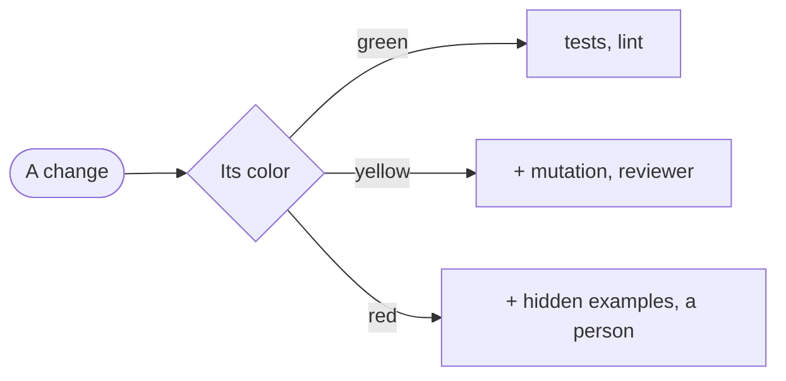

# The GDD contract

What the method leaves in a repository is the contract between the skills and any engine, T-minus included: an engine reads and writes these same files (decision 13 in [DESIGN.md](DESIGN.md)). This file is its only source. Each skill carries a copy of the templates it writes in its `assets/` folder, and `scripts/check_skills.py`, in this repository, fails if a copy differs from its template here. That check is ours: no project installs it.

The version of the contract is `gdd/1`. It goes in the front matter of the blueprint and of each brief, and in every event of the log.

## The files

| File | What it holds | Who writes it | How it changes |
|---|---|---|---|
| `AGENTS.md`, GDD block | The cross-cutting core, under 100 words, and the map. It imports the constitution | `gdd-prepare` | With the person's approval |
| `gdd/constitution.md` | The stack, the commands and the rules that hold everywhere | `gdd-prepare` | With the person's approval |
| `gdd/blueprint.md` | Levels, limits, checks, colors, zones and the context of each gate, in YAML front matter, plus a Mermaid diagram | `gdd-prepare`, `gdd-harden` | Protected by CODEOWNERS; the person approves |
| `gdd/gates/<zone>.feature` | The standing gates of a zone, in Gherkin | `gdd-prepare`, `gdd-harden`, with the person | Like the blueprint |
| `gdd/backlog.md` | What to build, each item with its expected color | `gdd-prepare`, `gdd-brief`, `gdd-harden` | Freely |
| `gdd/debt.md` | Known debt, with the baseline of each check | `gdd-prepare` | Down freely; up only with the person's approval |
| `gdd/briefs/<id>.md` | What the person approves for one change | `gdd-brief` | Never once approved: a new version goes back to the person |
| `features/<capability>.feature` | The scenarios of changes, grouped by capability | `gdd-brief`, with the person | Only through a brief |
| `gdd/log/<id>.jsonl` | Everything that happens to a brief, one event per line | `gdd`, from what each role reports | Only appended |
| `gdd/context/` | Copies of external references and research | `gdd-prepare` | Refreshed with a new date |

## Rules for every file

- **Ids** use lowercase letters, digits and hyphens: zones, checks, briefs, backlog items and scenarios.
- **Paths** are git pathspecs from the root of the repository, with `:(glob)` for patterns, so `git diff --name-only <base> -- <pathspec>` gives the same answer to everyone.
- **Hashes** are git blob hashes (`git hash-object <file>`), so anyone can recompute them without a script.
- **Approved files** are never edited by an agent: a brief changes through a new version, and the blueprint and the gates through a commit or pull request the person approves.
- **A green change** has no brief file. Its events go to `gdd/log/<id>.jsonl` like any other, with an id the orchestrator picks.

## The GDD block of AGENTS.md

`gdd-prepare` writes it between the two markers, so it can be replaced without touching the rest of `AGENTS.md`. If the project has a `CLAUDE.md`, it also adds a line `@AGENTS.md` to it, because Claude Code reads `AGENTS.md` only when there is no `CLAUDE.md`.

<!-- template: gdd-prepare/assets/agents-block.md -->
```markdown
<!-- gdd:begin -->
## GDD

This project uses Gate-Driven Development (contract gdd/1): a change is done when its gates pass, not when an agent says so.

- Edit only what your role owns: never a sealed check, and never `gdd/`, `features/` or the agents' own files (`AGENTS.md`, skills, settings) unless your role writes them.
- Get through gates with facts: the command, its exit code and its last lines.
- When something doesn't fit, stop and say why.

Map: `gdd/blueprint.md` zones and gates, `gdd/gates/` their scenarios, `gdd/briefs/` approved changes, `features/` scenarios of changes, `gdd/log/` what happened, `gdd/context/` references.

@gdd/constitution.md
<!-- gdd:end -->
```

## The constitution

<!-- template: gdd-prepare/assets/constitution.md -->
```markdown
# Constitution

What every agent needs at every gate and can't work out from the code. It goes into every call, so keep it short. A rule that matters in only one zone goes to that zone's context in the blueprint.

## Stack

- <languages, frameworks and their versions>

## Commands

Gates run these same commands, locally and in CI.

| What | Command |
|---|---|
| Install | `<command>` |
| Build | `<command>` |
| Test | `<command>` |
| Lint | `<command>` |

## Rules that hold everywhere

- <for example: prices are stored in cents>
```

## The blueprint

The front matter is what agents read; the diagram and the table are for the person. Its fields:

- `levels`: which model the project uses for each level. The skills never name one.
- `limits`: fix rounds per gate, and the caps of a whole change. Two fix rounds per gate is the default; the team sets the rest when preparing.
- `checks`: every check a gate can ask for, with its type (`machine`, `reviewer` or `person`) and, for machine checks, the exact command from the constitution.
- `colors`: what each color asks for. `checks` lists the ones that must pass, `level` is the level of the agents that work on it, and `back_to_person` says whether a change whose color rises to this one goes back to the person.
- `zones`: each zone's id, color, pathspecs and the file with its standing gates.
- `context`: each external reference or MCP server, and the zones or gates that get it (`<zone>`, or `<zone>/<Rule>` for one gate). MCP servers carry the least access their gate needs.

Anything no zone covers counts as red until the person classifies it. That rule isn't a field: no blueprint can turn it off.

<!-- template: gdd-prepare/assets/blueprint.md -->
````markdown
---
contract: gdd/1
levels:
  light: <model for little reasoning, cheap and fast>
  standard: <model for normal reasoning>
  deep: <model for the most reasoning>
limits:
  fix_rounds_per_gate: 2
  rounds_per_change: <n>
  minutes_per_change: <n>
  lines_per_change: <n, counted with git diff --shortstat>
checks:
  - id: tests
    type: machine
    command: <test command from the constitution>
  - id: lint
    type: machine
    command: <lint command from the constitution>
  - id: mutation
    type: machine
    command: <mutation command, on the files the change touched>
  - id: hidden
    type: machine
    command: <command that runs the hidden examples>
  - id: review
    type: reviewer
  - id: person-review
    type: person
colors:
  green:
    checks: [tests, lint]
    level: light
    back_to_person: false
  yellow:
    checks: [tests, lint, mutation, review]
    level: standard
    back_to_person: false
  red:
    checks: [tests, lint, mutation, hidden, review, person-review]
    level: deep
    back_to_person: true
zones:
  - id: <zone>
    color: <green, yellow or red>
    paths:
      - ':(glob)<pattern>'
    gates: gdd/gates/<zone>.feature
context:
  - file: gdd/context/<file>
    for: [<zone>]
---

# Blueprint

<Two or three sentences: what the project is, and what in it is delicate.>



| Zone | Color | Paths | What can go wrong |
|---|---|---|---|
| <zone> | <color> | `<pathspec>` | <in one line> |

On red, a person reviewing the change is recommended, not required: remove `person-review` from red if this project decides otherwise. Anything no zone covers counts as red until the person classifies it.
````

## The gates of a zone

Each `Rule:` is one thing a gate of the zone demonstrates. Under it go at least the scenario its check must reject (the bad case) and one it must accept, each tagged with the id of the check that covers it, as listed in the blueprint. A check of type `reviewer` is tagged the same way: its scenario is a question on the reviewer's exam.

<!-- template: gdd-prepare/assets/gates.feature gdd-harden/assets/gates.feature -->
```gherkin
@zone:<zone>
Feature: <Zone> gates

  Rule: <one thing this zone's gates demonstrate, in one sentence>

    @check:<check id>
    Scenario: <the bad case, which the check must reject>
      Given <a change that does the wrong thing>
      When the gate runs
      Then the <check id> check fails and names the file and the line

    @check:<check id>
    Scenario: <a good case, which the check must accept>
      Given <a change that does the right thing>
      When the gate runs
      Then the <check id> check passes
```

## The backlog

<!-- template: gdd-prepare/assets/backlog.md -->
```markdown
# Backlog

What to build, each item with its expected color. An item is done when what it builds is in use, not when its parts exist. Known debt and waived checks come here too, as items.

| Id | What | Color | Phase | Brief | State |
|---|---|---|---|---|---|
| gates-<zone> | Build the gates of <zone> and try to fool them | <color> | 0 | | todo |
| <id> | <what the person gets> | <color> | 1 | | todo |
```

`State` is `todo`, `briefed` or `done`. Phases are optional: the roadmap, when the person wants one, is this backlog ordered in phases.

## Known debt

<!-- template: gdd-prepare/assets/debt.md -->
```markdown
# Known debt

What already failed a check when GDD arrived, or a check a person waived. A baseline only goes down, and lowering it needs no approval. Raising one, or adding a line, loosens a check, so the person approves it.

| Check | Command | Baseline | Measured at | Zone | Backlog |
|---|---|---|---|---|---|
| <check id> | `<command>` | <number and unit> | <commit>, <date> | <zone> | <item id> |
```

## A brief

The front matter is what the other roles read; the body is what the person reads to approve it. No status and no seals: those go to the log.

<!-- template: gdd-brief/assets/brief.md -->
```markdown
---
contract: gdd/1
id: <id>
version: 1
color: <expected color>
zones: [<zone ids>]
touches:
  - '<pathspec>'
scenarios: [<ids of the scenarios it adds or changes>]
backlog: <item id>
---

# <What the person gets, in a few words>

## Request

<The person's words.>

## What changes

<A few sentences: what someone will be able to do, and what stays as it was.>

## Scenarios

<Each id it adds or changes, with one line on what it says. The scenarios live in features/.>

## What it touches

<The pathspecs, including twins, wiring, fixtures and the tests that assert the behavior it changes.>

## Color

<The expected color: the zones its paths fall in, and anything judgment raised, with the reason.>

## Gates

| Gate | Checks | Context |
|---|---|---|
| <zone>/<Rule>, or its own scenarios | <check ids> | <files from gdd/context/, or none> |

## Decisions

<Each decision the person made while briefing. None is left as a decision marker.>

## Undoing it

<How it's undone if it goes wrong, and what its gates can't see.>
```

## The scenarios of changes

Tests cite the id of the scenario they check as `gdd:<id>`, in their name or a comment, so `git grep -nw "gdd:<id>"` finds them.

<!-- template: gdd-brief/assets/scenarios.feature -->
```gherkin
Feature: <capability, as the person names it>

  @brief:<brief id> @id:<capability>-<n>
  Scenario: <what happens, in one line>
    Given <the starting state>
    When <what someone does>
    Then <what they can observe>
```

## The copies in gdd/context

Every copy starts with where it came from and when it was copied. Which gate gets it is in the blueprint.

<!-- template: gdd-prepare/assets/context.md -->
```markdown
---
source: <URL, or where it came from>
date: <YYYY-MM-DD>
---
```

## The report every role ends with

Every role ends its last message with this block, filled in. `gdd` copies it into the log. A missing block is the canary: it means the skill wasn't followed.

<!-- template: report -->
```gdd-report
skill: <skill> <version>
level: <light, standard or deep>
rounds: <how many rounds it took>
result: <what it leaves, in a word or two>
caught: <what it caught that others missed, or none>
seconds: <the time, if its environment gives it, or unknown>
tokens: <the tokens, if its environment gives them, or unknown>
```

## The log

One JSON object per line, appended when each step closes and never rewritten. Every event has `contract`, `ts` (UTC, ISO 8601), `brief` and `event`. A person's actions are `approval` and `waiver`; everything a role does is a `step`, with its report and the fields of its step. A step that stops carries `stop`. `gates` is the orchestrator running the checks out of the agent's reach, and has no report.

<!-- template: gdd/assets/log-events.jsonl -->
```json
{"contract":"gdd/1","ts":"<UTC time>","brief":"<id>","event":"approval","who":"<person>","of":"<brief, blueprint, gates, debt or waiver>","version":1,"files":{"<path>":"<git blob hash>"},"where":"<commit or pull request URL>"}
{"contract":"gdd/1","ts":"<UTC time>","brief":"<id>","event":"waiver","who":"<person>","check":"<check id>","why":"<reason>","backlog":"<item id>"}
{"contract":"gdd/1","ts":"<UTC time>","brief":"<id>","event":"step","step":"prepare","report":{"skill":"gdd-prepare","version":"<version>","level":"deep","rounds":1,"result":"<result>","caught":"<what, or none>","seconds":null,"tokens":null},"files":["<path>"]}
{"contract":"gdd/1","ts":"<UTC time>","brief":"<id>","event":"step","step":"brief","report":{"skill":"gdd-brief","version":"<version>","level":"standard","rounds":1,"result":"<color>","caught":"<what, or none>","seconds":null,"tokens":null},"color":{"on":"planned","base":"<commit>","zones":["<zone>"],"uncovered":[],"floor":"<color>","color":"<color>","why":"<what raised it, or empty>"}}
{"contract":"gdd/1","ts":"<UTC time>","brief":"<id>","event":"step","step":"checks","report":{"skill":"gdd-checks","version":"<version>","level":"<level>","rounds":1,"result":"sealed","caught":"<what, or none>","seconds":null,"tokens":null},"seal":{"commit":"<commit>","checks":{"<path>":"<git blob hash>"},"hidden":"<commit of the hidden examples, or null>","proofs":[{"check":"<check id>","case":"rejects","command":"<command>","exit":1,"tail":"<last lines>"},{"check":"<check id>","case":"passes","command":"<command>","exit":0,"tail":"<last lines>"}]}}
{"contract":"gdd/1","ts":"<UTC time>","brief":"<id>","event":"step","step":"build","report":{"skill":"gdd-build","version":"<version>","level":"<level>","rounds":1,"result":"<done or stopped>","caught":"<what, or none>","seconds":null,"tokens":null},"claims":[{"check":"<check id>","command":"<command>","exit":0,"tail":"<last lines>"}]}
{"contract":"gdd/1","ts":"<UTC time>","brief":"<id>","event":"step","step":"gates","where":"<ci, or a clean copy>","gates":[{"check":"<check id>","command":"<command>","exit":0,"tail":"<last lines>","result":"<pass or fail>"}]}
{"contract":"gdd/1","ts":"<UTC time>","brief":"<id>","event":"step","step":"review","report":{"skill":"gdd-review","version":"<version>","level":"<level>","rounds":1,"result":"<pass, fix or stop>","caught":"<what, or none>","seconds":null,"tokens":null},"color":{"on":"touched","base":"<commit>","head":"<commit>","zones":["<zone>"],"uncovered":[],"floor":"<color>","color":"<color>","why":"<what raised it, or empty>"},"verdict":"<pass, fix or stop>","ran":[{"command":"<command>","exit":0,"tail":"<last lines>"}],"findings":[{"where":"<file:line>","what":"<one line>"}]}
{"contract":"gdd/1","ts":"<UTC time>","brief":"<id>","event":"step","step":"harden","report":{"skill":"gdd-harden","version":"<version>","level":"deep","rounds":1,"result":"proposed","caught":"<what, or none>","seconds":null,"tokens":null},"crack":"<where it got through>","scenario":"<file and Rule>","proposal":"<the blueprint change>"}
{"contract":"gdd/1","ts":"<UTC time>","brief":"<id>","event":"step","step":"<step>","report":{"skill":"<skill>","version":"<version>","level":"<level>","rounds":1,"result":"stopped","caught":"none","seconds":null,"tokens":null},"stop":{"reason":"<why it stopped>","needs":"<what would unblock it>"}}
```

The hidden examples stay outside the working tree of the agent that builds (another branch or worktree) until it finishes, and their commit is in the log from the moment they're sealed, before that agent starts. Without an engine this is a rule that git helps with, not a guarantee.

## Finding what's missing

Traceability needs no script, only greps:

- A scenario without a test: for each `@id:` in `features/`, `git grep -nw "gdd:<id>"` finds nothing.
- A check no gate asks for: an id in the blueprint's `checks` with no `@check:<id>` in `gdd/gates/` and in no color.
- A decision nobody has made: `git grep -n "\[DECISION:" -- gdd/briefs features` finds something.
- A brief that changed after its approval: `git hash-object gdd/briefs/<id>.md` differs from the last `approval` of that brief in its log.
- A sealed check that changed: `git diff --stat <seal commit> HEAD -- <sealed paths>` shows anything.
