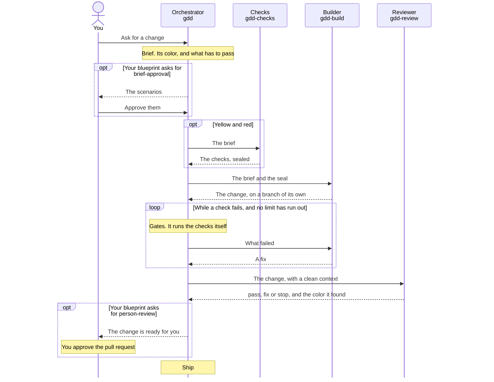
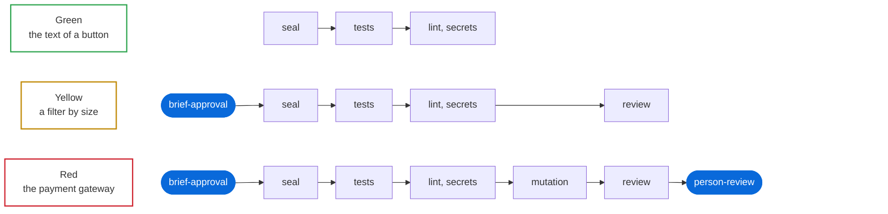

# The GDD skills

You ask your agent for a filter by size in the catalog. One agent writes down with you what has to pass, another builds the checks, a third does the work, and a reviewer that heard none of it runs the change and tries to make it fail. You hear about it when it needs you, and when it's in.

That's a lot to explain every time, so it's written down once, in seven skills. A skill is a file of instructions your agent loads when it needs it. These install nothing and run nothing of their own: they use what your project already has, its tests, its linter, its CI and git. The one script they carry is a small runner they offer your project when preparing, so that the log says what each check took. If you take it, it's yours.

This is version 0.8, with contract `gdd/1`.

## The four moments


Prepare happens once, in a conversation with you. From then on every change goes through Brief and Execute, and it comes to you when it needs you: an approval your blueprint asks for, a decision nobody has made, a limit that ran out. Harden is for the day something gets past every gate, or keeps repeating, so that what it would have taken to catch it stays as a check, and for the day a gate stops adding anything, so that it gets relaxed or retired. The two keep the balance.

| Step | You say | You end up with |
|---|---|---|
| [1. Install the skills](#1-install-the-skills) | A command or two | The seven skills in your agent |
| [2. Prepare your project](#2-prepare-your-project) | "Set GDD up in this project" | A blueprint you approved, with the gates your project needs |
| [3. Ask for a change](#3-ask-for-a-change) | The change, in your own words | The change on your main branch, and a log of how it got there |
| [4. Harden what slipped through](#4-harden-what-slipped-through) | What got through, what keeps repeating, or the gate that no longer adds anything | A check that catches it from then on, or a gate relaxed or retired |

## Before you start

- **A git repository.** The skills use what it already has, such as its tests, its linter or its CI.
- **An agent that loads skills.** Claude Code, Codex or Antigravity.
- **You, or your team.** GDD works on your own or with a team. With a team, the team approves the blueprint and anything that loosens it, as its `CODEOWNERS` say, and the author of a change approves what has to pass for it. On your own, you are both.
- **Your agent's deepest model, for Prepare and Harden.** If you aren't on it, the orchestrator tells you before it starts.
- **Protected branches, if your platform has them.** The skills work without them, but then nothing stops the agent from touching what judges it ([what they don't guarantee](#what-they-dont-guarantee)).

## 1. Install the skills

Pick your agent. Each one reads its own manifest from this repository, and none of them brings code.

**Claude Code**, 2.1.275 or later:

```
/plugin install gdd --marketplace MarsGotta/gdd
```

**Codex:**

```
codex plugin marketplace add MarsGotta/gdd
codex plugin add gdd@gdd
```

**Antigravity:**

```
git clone https://github.com/MarsGotta/gdd
agy plugin install gdd
```

**By hand,** if you'd rather keep them inside your project: copy the seven folders whose names start with `gdd` into `.claude/skills/` for Claude Code, or `.agents/skills/` for Codex. For Claude Code, copy the subagents in [adapters/](adapters/) to `.claude/agents/` as well.

Then check it's there:

| Agent | Command | What you should see |
|---|---|---|
| Claude Code | `claude plugin list` | `gdd@gdd`, enabled |
| Codex | `codex plugin list` | `gdd@gdd`, installed and enabled |
| Antigravity | `agy plugin list` | `gdd`, enabled, with 7 skills |

From a plugin, the names carry its prefix on Claude Code and Codex: `gdd:gdd`, `gdd:gdd-build` and so on. You rarely type them, because `gdd` loads by itself and launches the rest.

## 2. Prepare your project

**You say:**

```
Set GDD up in this project
```

**What happens.** The orchestrator loads `gdd-prepare` and sits down with you to decide what is delicate in your project and which gates it needs.

1. **It proposes first.** You get the usual zones and gates for a project like yours, to correct what doesn't fit. It asks only what changes a zone or a gate: money, accounts and permissions, personal or regulated data, the stack, what can't be undone. It also asks, before one happens, what an emergency may skip and who opens that gate.
2. **You mark the zones.** A zone is a set of paths with a color, by how much damage a change there can do: green, yellow or red. What no zone covers is never green: the orchestrator judges it in each change, tells you why, and asks when it can't tell. In a repository with history, it tries the zones on your last commits before you approve: how many would have come out of each color, what no zone covers and where the fixes fell.
3. **You agree on the gates.** They are yours to decide, and they differ with the area and the project. Each one is written as a short feature in Gherkin, which says which checks it asks of each color and what it rejects; the blueprint holds what runs, and the two are compared when the checks are set up. Few, but strict, and the same for every change: a zone only gives a change its color, and the color says how much each gate asks. Two things come proposed in every project: a scan that keeps secrets out of the repository, and the dependency manifests in a zone where a person reviews, so that no new dependency comes in unseen.
4. **You choose the models.** It looks at which agents you have installed and which models each one offers, and proposes one for each level (light, standard and deep) and the reviewer's apart, from another model family where you have one. You say yes or correct it, and it launches a role on each one before it counts, so the blueprint never says light while everything runs on the deep model.
5. **The protections get set up and tried.** It writes a `CODEOWNERS` file that asks for a person's review on what you or your team always approve, and gives you the rest to apply on your platform, because that takes your credentials. Then it tries four things from the environment the builder will work in, pushing to the main branch among them. If they all fail, your blueprint's `guarantee` is `platform`. If any succeeds, it's `rule`, and it tells you.
6. **You approve the blueprint,** or your team does, with a commit or a pull request from a person. The caps of a change (rounds, minutes and lines) go in it, and you set them together.
7. **The checks get set up and tried, once.** `gdd-checks` sets them up, with a tool that already exists before a script of your own, and `gdd-review` tries each one on purpose: it has to reject something done wrong, accept it done right, and hold when a change tries to switch it off. No change starts until they are on the main branch.

**You end up with** files you can read, which make sense without the skills:

```text
AGENTS.md                    the GDD block: the cross-cutting core, under 100 words, and the map
CODEOWNERS                   what you or your team always approve
gdd/
├── blueprint.md             gates, zones, colors, checks, levels and limits
├── gates/                   one feature for each gate: what it asks of each color, and what it rejects
├── check.sh                 your runner, if you take it: it times each check and says what it took
├── constitution.md          the stack, the commands and the rules that hold everywhere
├── backlog.md               what to build, each item with its expected color
├── debt.md                  known debt, with the baseline of each check
└── context/                 copies of the references a gate needs
```

## 3. Ask for a change

**You say** the change, in your own words. There's no command to remember: `gdd` loads by itself in a project that has a blueprint.

```
Add a filter by size to the catalog
```

**What happens.** The orchestrator hands out the work and builds none of it. Whoever writes the cases, whoever builds and whoever reviews each work in a separate agent, which starts without the others' conversation: it gets what they left written, not how they got there.



1. **Brief.** The paths the change will touch set the floor of its color, and the orchestrator's judgment can raise it, never lower it. On yellow and red it writes the brief and its scenarios: what someone can observe, with the bad cases too. When it finds a decision nobody has made, such as a limit with no number or what happens with an empty list, it asks you. Where your blueprint asks for `brief-approval`, nothing is built before you approve.
2. **Checks.** Another agent, never the one that will build, writes the cases the color asks for, a test for each scenario. It sees each one fail for the right reason, proves it can pass and seals them. A green change has no brief and skips this step: it goes on with the checks that already exist.
3. **Build.** The builder works on a branch of its own, with the brief and the seal. It never gets the log, or the conversation where its checks were made.
4. **Gates.** The orchestrator runs the checks itself, away from the builder: CI on its branch, or a fresh clone. On `guarantee: rule` that clone is the best there is and it isn't out of the builder's reach, and the orchestrator says so in its summary. What the builder reports is a claim. A check that fails sends the change back with its command, its exit code and its last lines.
5. **Review.** A reviewer with a clean context runs the change and tries to make it fail. Its verdict is `pass`, `fix` or `stop`, and it works the color out again on what was actually touched. That color can only go up, and if it rose, the change goes back to Brief.
6. **Ship.** With every check passed, the change is brought up to date with your main branch and the machine checks run again. Where your blueprint asks for `person-review`, you approve the pull request on your platform. The orchestrator never approves anything.

**What you hear.** One line per gate, passed or failed and in how many rounds. The detail comes only when something fails or you have to decide, and a summary closes it. For the filter by size it could go like this, in your agent's own wording:

```text
brief     yellow: it touches catalog/. Three scenarios wait for your approval
checks    sealed, each one seen failing first
seal      passed
tests     failed, round 1: a size with no results
tests     passed, round 2
lint      passed
review    fix: the filter is lost on page 2
review    pass, yellow
```

**You end up with** the change on your main branch and its trail next to it:

```text
gdd/briefs/<id>.md               what had to pass, on yellow and red
features/<capability>.feature    its scenarios
gdd/log/<id>.jsonl               everything that happened, one event per line, with who approved what
```

### What each color asks for



The rounded blue steps are where a person approves. This is the proportion the blueprint's template brings, and yours decides: which checks each color asks for, and where a person approves, are for you or your team to decide. Whatever its color, a change also passes the gates of the zones it touches, where a zone has gates of its own, and it gets its reviewer, which on green only works the color out again and checks that nothing that judges was touched.

Each color also sets the level of the agents that work on it (light, standard or deep), and your blueprint says which model each level is in each agent you work from, by the name that agent launches it with.

## 4. Harden what slipped through

**You say** which failure got through and where you found it, or what keeps repeating: the same finding, the same stop, the same reason for raising a color. Fixing it is a normal change, through step 3. Hardening is the other half: what it would have taken to catch it stays as a check. Or you say which gate is in the way, and the orchestrator reads the logs for what it caught and what it cost.

```mermaid
flowchart LR
    accTitle: Hardening, step by step
    accDescr: Something slipped through, or keeps repeating. The orchestrator finds the crack in the brief and the log, proposes the scenario that would have caught it, you or your team approve the change to the blueprint, the check is built and tried, and every later change in that zone passes it.
    S(["It slipped<br/>through"]) --> C["Find<br/>the crack"]
    C --> P["The scenario that<br/>would have caught it"]
    P --> A(["You<br/>approve it"])
    A --> K["The check is built,<br/>and tried"]
    K --> E(["Later changes in<br/>that zone pass it"])
    %% An empty node keeps the right side free: GitHub draws its zoom buttons there
    E ~~~ Z["zoom buttons"]
    classDef you fill:#0969da,stroke:#0969da,color:#ffffff
    classDef room fill:none,stroke:none,color:transparent
    class A you
    class Z room
```



1. **Someone who knows that part of the product confirms it.** The failure is real, and this is where it was.
2. **The orchestrator finds the crack.** It reads the brief and the log of the change that let it through, and works out which gate should have caught it and what that gate was missing.
3. **It proposes the scenario that would have caught it,** with its bad case first, and the check that will cover it: a machine check where a machine can tell, a question for the reviewer where none can. It never proposes a paragraph of instructions, because a new line in `AGENTS.md` costs at every gate and checks nothing.
4. **You approve the change to the blueprint and its gates,** or your team does, with a pull request or a commit from a person.
5. **The check gets built and tried.** `gdd-checks` builds it and `gdd-review` tries to fool it before it counts. When the failure got past a reviewer, the change that carried it also joins the reviewer's exam, in `gdd/exam.md`.

Hardening goes the other way too. The log keeps what each check took every time it ran, so your blueprint can say what would make you simplify as a figure the logs can count. A check, or a question of the reviewer's, that reaches it gets proposed for retirement, with what it caught and what it cost, and that's for you or your team to approve as well. A new model on one of your levels is no reason to drop a check, which judges your product and not the model: after a few changes the orchestrator reads the logs and may propose a lighter level or lower limits for a color.

## When it stops

| You see | What it means | What you do |
|---|---|---|
| It waits for your approval | Your blueprint asks for a person there: the brief before anyone builds, or the pull request at the end | Read it and approve it. No agent can do that for you |
| `[DECISION: ...]` in a brief | A rule two people would build differently, or a limit with no number | Answer it. Your answer goes into the brief |
| A check failed | A fix round. The builder gets the command, its exit code and its last lines | Nothing, unless a limit runs out |
| `fix` from the reviewer | A fix round, with the reviewer's notes | Nothing |
| `stop` from the reviewer | The change doesn't go in, whatever else the answer says | Read why |
| The color rose | The change touched something more delicate than the brief expected, so it goes back to Brief | Approve the new brief, if that color asks for it |
| `CANNOT:` and a reason | A role stopped because the change doesn't fit as it was briefed | The brief gets a new version. It comes back to you if what has to pass changes and its color asks for your approval |
| The `seal` check failed | Something that judges the change was touched | The change stops, and the orchestrator tells you |
| A limit ran out | Too many rounds, minutes or lines for one change | Decide how to rethink it, as a series of smaller changes for instance |
| A check fails without the change too | Known debt, or an unstable check | Recording debt and quarantining a check are decisions for you or your team, never for an agent |
| You need to skip a check, in an emergency | Skipping a check loosens it. Your blueprint says beforehand what an emergency may skip, and who opens that gate | That person approves it. It's logged as a waiver, with who and why, and the change goes through what it skipped afterwards |
| Your agent can't launch other agents | It gives you one line per role | Open a new session with it, such as `/gdd:gdd-build gdd/briefs/<id>.md` |

A fix never goes into a looser check. When a check looks wrong, only whoever wrote it or a person corrects it, never the agent that has to pass it.

## Reference

### The seven skills

| Skill | Who loads it | Moment | What it leaves |
|---|---|---|---|
| `gdd` | The orchestrator, on its own, when you ask for any change | All four | What comes next, and who gets launched |
| `gdd-prepare` | The orchestrator, with you | Prepare | The blueprint, with the gates the project needs, and the constitution |
| `gdd-brief` | The orchestrator | Brief | What has to pass, as scenarios, and the expected risk |
| `gdd-checks` | Another agent, never the one that builds | Brief, and after Prepare and Harden | The checks, each seen failing for the right reason |
| `gdd-build` | The agent that goes through the gate | Execute | The change, and the facts that prove it |
| `gdd-review` | The reviewer, with a clean context | Execute | Its verdict, and the risk worked out again |
| `gdd-harden` | The orchestrator, with you | Harden | The crack and the check that would have caught it, or the proposal to retire a gate |

What was decided about them, and why, is in [DESIGN.md](DESIGN.md). Every file they leave in your repository, with its template, is in [CONTRACT.md](CONTRACT.md): an engine will read and write those same files, so what you set up today will still serve you later. The mapping of each role to its skill, for each agent, is in [adapters/](adapters/).

### What they don't guarantee

Without an engine, the agent not touching what judges it is a rule: the skills tell it so and then check that it hasn't, but nothing stops it. Your blueprint says which of three degrees you're at.

| `guarantee` | What keeps the builder away from what judges it |
|---|---|
| `rule` | The skills tell it, and the `seal` check finds out afterwards |
| `platform` | Protected branches and your platform's permissions, each one seen closing when you prepared |
| `engine` | An engine. [T-minus](https://github.com/MarsGotta/t-minus) is still in development |

## Keeping them in line

`python3 scripts/check_skills.py`, from the root of this repository, checks that every skill's templates match the contract and that each skill keeps to its design. `python3 scripts/check_commands.py` runs the git commands the skills give in a throwaway repository. And [`evals/`](../evals/) holds scenarios that check, with a real model, how an agent behaves with the skills. All of it is for this repository: your project doesn't need it.
