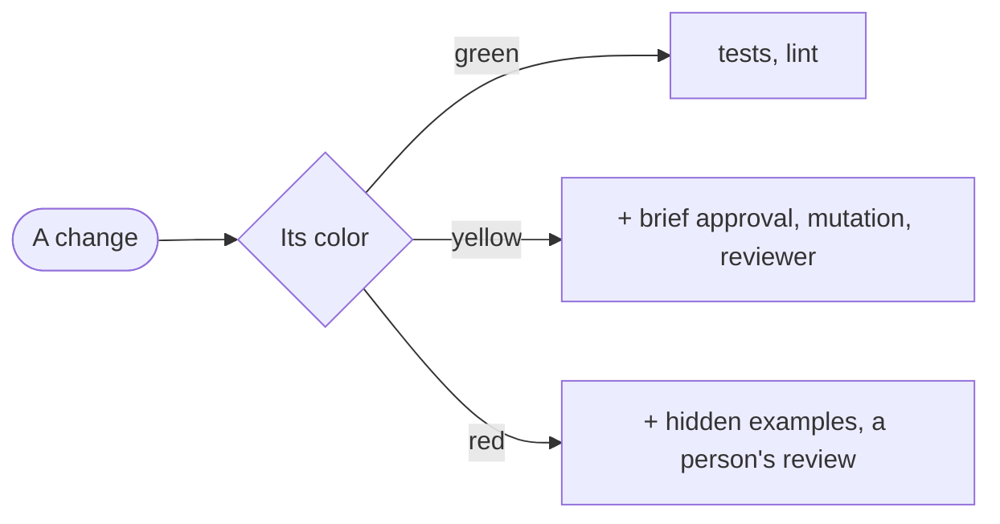

# Blueprint

<Two or three sentences: what the project is, and what in it is delicate.>

| Zone | Color | Paths | What can go wrong |
|---|---|---|---|
| <zone> | <color> | `<pathspec>` | <in one line> |

Where a person approves is this project's decision. `brief-approval` on yellow and red and `person-review` on red are a proposal: add or remove them in `colors`, on any color. Removing one later loosens a gate, so the person approves it. Anything no zone covers counts as red until the person classifies it.
