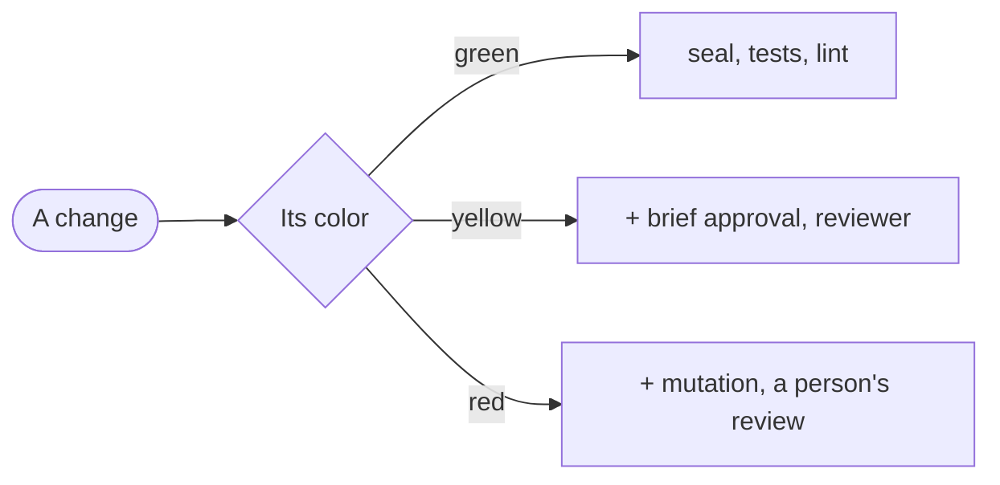

# Blueprint

<Two or three sentences: what the project is, and what in it is delicate.>

| Zone | Color | Paths | What can go wrong |
|---|---|---|---|
| <zone> | <color> | `<pathspec>` | <in one line> |

Where a person approves is this project's decision. `brief-approval` on yellow and red and `person-review` on red are a proposal: add or remove them in `colors`, on any color. Removing one later loosens a gate, so the person approves it. Take `mutation` out of red if the stack has no mature tool for it, and add it to yellow if it has one and the team wants it. From `platform` up, red can ask for a `hidden` check too: more examples of the same scenarios, kept where the builder's credentials can't read them. Anything no zone covers counts as red until the person classifies it.

## Baseline

Measured on <date>, over <n> changes, before GDD: <time from request to release>, <stops per change>, <what slipped through>.

## What would make us simplify

<The figure that would make this team drop a gate, in one sentence.>
