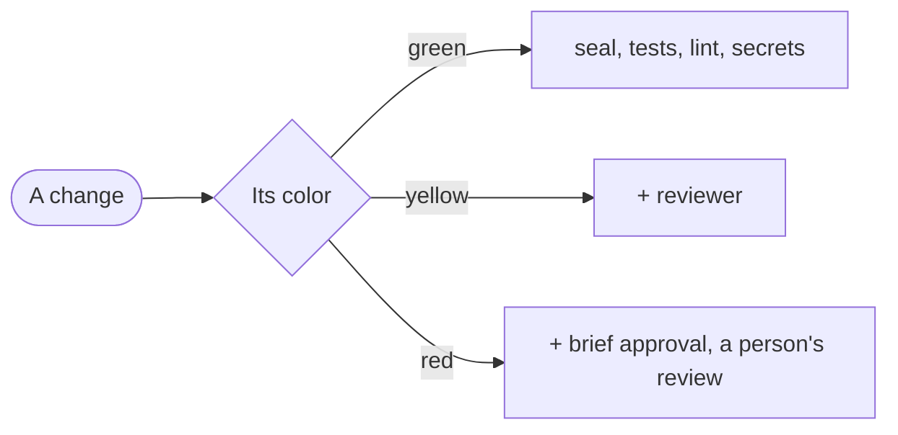

# Blueprint

<Two or three sentences: what the project is, and what in it is delicate.>

| Zone | Color | Paths | What can go wrong |
|---|---|---|---|
| <zone> | <color> | `<pathspec>` | <in one line> |

| Check | What it catches | When it runs | Colors |
|---|---|---|---|
| <check> | <in the person's words> | <every round, or once before the review> | <colors> |

Where a person approves is this project's decision. `brief-approval` and `person-review` on red are a proposal: on yellow the brief and its scenarios are still written, the person is told in a line what the change will do, and nobody waits for them. Add or remove them in `colors`, on any color: the person, or their team, can ask for `brief-approval` on yellow too. Removing one later loosens a gate, so the person approves it. A change goes through its checks in two tiers: each round, the seal, the tests of the change, lint and types and the secret scan, under two minutes together; then once, before the reviewer, what takes longer, such as one browser test of what the change touches when it touches what a person sees, under ten minutes in all. The caps of each color are a start, which the project's logs correct, and a limit that runs out stops the change. Mutation testing and a threshold of coverage are in no color at the start: hardening adds them, at their tool's own default, when the tests proved weak. A check that not every color asks judges only what the change adds or changes: if it judged the whole code, the first change of that color would answer for what the lighter ones shipped. From `platform` up, red can ask for a `hidden` check too: more examples of the same scenarios, kept where the builder's credentials can't read them, a place the front matter names in `hidden`. Anything no zone covers is never green, and it stops no change: when the orchestrator briefs the change, it judges the path against what this blueprint marks as delicate, yellow unless it does what a red zone does, and it asks only when it can't tell.

## Emergencies

<What an urgent change may skip, who opens that gate and what it may never skip. A person opens it, it's written to the log as a waiver, and the change goes through what it skipped afterwards.>

## Baseline

Measured on <date>, over <n> changes, before GDD: <time from request to release>, <stops per change>, <what slipped through>.

## What would make us simplify

<The figure that would make this team drop a check, or a question of the reviewer's, as something its logs can count: how many changes it ran on without catching anything real, or what it may cost each one.>
