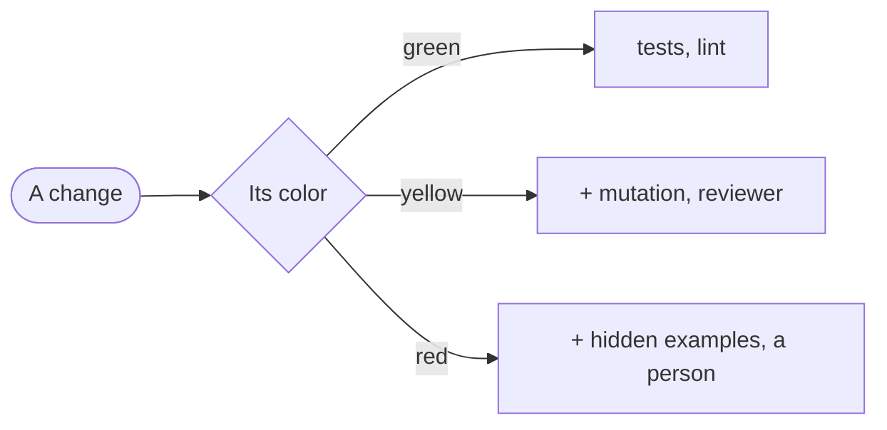

# Blueprint

<Two or three sentences: what the project is, and what in it is delicate.>

| Zone | Color | Paths | What can go wrong |
|---|---|---|---|
| <zone> | <color> | `<pathspec>` | <in one line> |

On red, a person reviewing the change is recommended, not required: remove `person-review` from red if this project decides otherwise. Anything no zone covers counts as red until the person classifies it.
